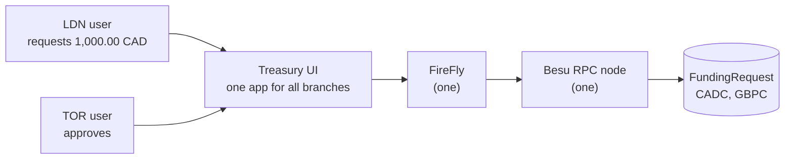
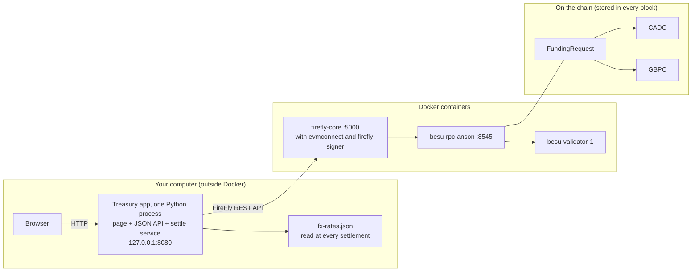

# Treasury use case: cross-border branch funding

> **Owner:** Howin Ho · **Created:** 2026-10-18 · **Status:** Implemented and checked on the live stack (2026-10-19). The recommended answers to [prd.md](prd.md) §9 were used; the decisions are D-18 to D-24 in `docs/plan.md`
> Source: `/grill-me` interview (2026-10-18). Decisions are numbered TD-01 and up so they do not collide with the project's D-xx in `docs/plan.md`.

## What this adds

A company with branches in several countries funds one branch from another. London (LDN) asks for money in CAD. Toronto (TOR) approves. The treasury converts CAD to GBP at a fixed FX rate. LDN receives GBP and redeems it. Everything runs on the existing network: **one Besu RPC node, one FireFly, and one UI that serves everybody**.

## The flow in one table

| Step | Who | What happens | On-chain effect |
|---|---|---|---|
| 1 | LDN user | Enters a CAD amount in the UI. The processing date is LDN's local date | none yet |
| 2 | UI, through FireFly | Sends `createRequest` | request `Requested` |
| 3 | TOR user | Approves in the UI | request `Approved`, **CADC minted** to the treasury wallet |
| 5 | UI (treasury service) | Sees the CADC and looks up the CAD to GBP rate | none |
| 6 | UI, signing as treasury | Sends `settle` | **CADC burned**, **GBPC minted** to the LDN wallet, rate recorded, request `Settled` |
| 7 | LDN wallet | `redeem` | **GBPC burned**, request `Redeemed` |

(The numbering follows your request; there was no step 4.)

## Where everything is

**Short answer.** The source is in this repository (table 1). When it runs, the **contracts live on the chain** inside the Besu containers, and the **web app is one Python process on your own computer**, not in Docker (table 2).

### 1. In the repository

| What | Where |
|---|---|
| The two contracts (the chain code) | [contracts/treasury/contracts/](../../contracts/treasury/contracts/): `CurrencyToken.sol` (`CADC` and `GBPC`), `FundingRequest.sol` |
| Contract tests (Solidity) | [contracts/treasury/test/](../../contracts/treasury/test/) |
| The compiled contracts that are deployed (committed) | [contracts/treasury/compiled/](../../contracts/treasury/compiled/): `CurrencyToken.json`, `FundingRequest.json`, `SHA256SUMS` |
| The rules in Python (no I/O): money, FX, state machine, the calls to FireFly, the settle-and-redeem service, the deploy plan | [src/core/treasury/](../../src/core/treasury/) |
| The deploy command (`python scripts/stack.py treasury`) | [src/adapters/treasury_deploy.py](../../src/adapters/treasury_deploy.py), registered in [src/adapters/stack_cli.py](../../src/adapters/stack_cli.py) |
| The web server and its JSON API | [src/adapters/treasury_http.py](../../src/adapters/treasury_http.py), [src/adapters/treasury_api.py](../../src/adapters/treasury_api.py) |
| Putting the app together, and the start command | [src/adapters/treasury_app.py](../../src/adapters/treasury_app.py), started by [scripts/treasury_app.py](../../scripts/treasury_app.py) |
| The web page (three files) | [src/adapters/treasury_ui/](../../src/adapters/treasury_ui/): `index.html`, `app.js`, `app.css` |
| The FX rates | [network-config/treasury/fx-rates.json](../../network-config/treasury/fx-rates.json) |
| The wallets (names, addresses, demo private keys) | [network-config/wallets.json](../../network-config/wallets.json) |
| Unit tests | [tests/unit/core/test_treasury_*.py](../../tests/unit/core/) and [tests/unit/adapters/test_treasury_*.py](../../tests/unit/adapters/) |
| Integration tests (live stack) | [tests/integration/test_treasury_flow.py](../../tests/integration/test_treasury_flow.py) |

### 2. While it runs

| Part | Runs where | How to find it |
|---|---|---|
| **The contracts** | On the chain, in the state kept by `besu-validator-1` and `besu-rpc-anson` (Docker). They have no process of their own; they run when a transaction calls them | Addresses are in `deployed-addresses.json` under `cadc`, `gbpc` and `funding-request` (not committed; rewritten by every deploy, and different after a `reset`). Or ask FireFly, see [chaincode-explained.md](chaincode-explained.md) §6 |
| **The web app** (page, JSON API, settle service) | **One Python process on your computer**, not in Docker. It exists only while the terminal that ran `python scripts/treasury_app.py` is open | http://127.0.0.1:8080/ . It prints one JSON line per treasury step in that terminal. Stop it with Ctrl+C. If it is not running, the page says "Failed to fetch", but nothing on the chain is lost |
| **FireFly** (REST API, signing, sending) | Docker: `firefly-core` (port 5000, also the Explorer at `/ui`), `firefly-evmconnect`, `firefly-signer` (no published port) | `docker ps` |
| **The chain** | Docker: `besu-validator-1` makes the blocks; `besu-rpc-anson` (port 8545) is the door | `docker ps`; `curl localhost:8545` |
| **The wallets' keys** | `wallets.json` (committed demo keys) and encrypted keystores in `network-config/firefly/signer-data/keystore/` (not committed, rebuilt by `stack.py treasury`) | [wallets-explained.md](wallets-explained.md) |
| **The FX rates** | The file on your disk, read each time a request is settled, so editing it needs no restart | [network-config/treasury/fx-rates.json](../../network-config/treasury/fx-rates.json) |

The web app is **not** started by `docker compose up`. That is a deliberate v1 choice (PRD question Q9): you start it yourself after `up`, `deploy` and `treasury`. The contracts, by contrast, survive without it: if the app is stopped, requests already on the chain stay where they are, and the next start finishes any that were left `Approved` or `Settled`.

## Documents

| Document | Read it for |
|---|---|
| [use-case.md](use-case.md) | Actors, the flow as sequence diagrams, the request state machine, failure paths |
| [prd.md](prd.md) | User stories, functional and non-functional requirements, scope, **Open Questions** |
| [design.md](design.md) | Contracts, FireFly API shape, UI/API, layering, decisions TD-01 to TD-12, risks |
| [tasks.md](tasks.md) | Ordered task list with a verification step for each task |
| [test-plan.md](test-plan.md) | Unit, contract and integration tests, invariants, traceability |
| [tokens-explained.md](tokens-explained.md) | **Teaching guide:** what CADC and GBPC are, and `CurrencyToken.sol` explained line by line |
| [chaincode-explained.md](chaincode-explained.md) | **Teaching guide:** the `FundingRequest` contract (the chain code) explained line by line, why each rule exists, how to read and change it |
| [middleman-and-atomicity.md](middleman-and-atomicity.md) | **Discussion:** the `treasury` wallet as the middleman and how far to trust it; how burning CAD and minting GBP stays one unit of work; what is and is not atomic; failure matrix; proof |
| [wallets-explained.md](wallets-explained.md) | **Teaching guide:** the `ldn`, `tor` and `treasury` wallets, how they are made and sign, what each can and cannot do |

## Scope change you need to accept

The project PRD lists three things as out of scope that this use case needs:

| PRD item | Why this use case touches it | Proposed handling |
|---|---|---|
| FR-22 a web frontend | Your flow starts and ends in a UI | A minimal UI, local only, in a new adapter (TD-07) |
| FR-24 multiple asset types beyond `COIN` | CAD and GBP are two more tokens | Two plain tokens, separate from `COIN` and from T-REX (TD-01) |
| FR-21 authentication on any API | Two branches use one UI | **Not added.** The UI has a demo "act as" selector. The contracts enforce roles, so the chain, not the UI, is the authorization boundary (TD-09) |

Nothing here changes the network, `COIN`, the Paladin nodes or the existing tests.

## Assumptions I made that you have not confirmed

These are in [prd.md](prd.md) §9 with a recommended answer each. The ones that change the design most:

1. **TOR approval and the 4-eyes rule:** the approver must hold the approver role and must not be the requester.
2. **Step 7 "burnt"** means the LDN wallet redeems its GBP (fiat paid out off-chain); the app triggers it automatically after settlement.
3. **Rounding:** GBP amounts round down to the penny.
4. **FX table:** fixed file, dated entries with a `default`. A missing rate stops settlement; it never guesses.
5. **Compiling new Solidity** is new for this repo (it has only deployed vendored artifacts so far). Proposed: compile once with a pinned `solc`, commit artifacts and `SHA256SUMS`, as `contracts/paladin/` does.
