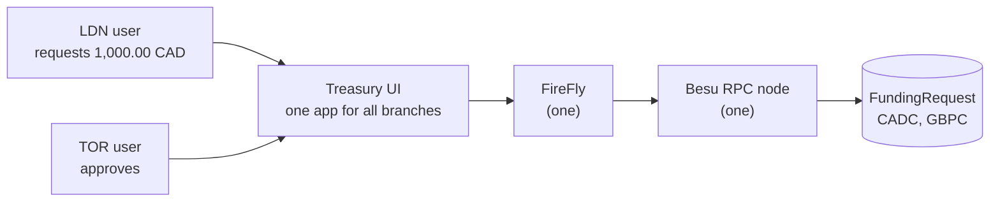

# Treasury use case: cross-border branch funding

> **Owner:** Howin Ho · **Created:** 2026-10-18 · **Status:** Implemented and checked on the live stack (2026-10-19). The recommended answers to [prd.md](prd.md) §9 were used; the decisions are D-18 to D-24 in `docs/plan.md`
> Source: `/grill-me` interview (2026-10-18). Decisions are numbered TD-01 and up so they do not collide with the project's D-xx in `docs/plan.md`.

## What this adds

A company with branches in several countries funds one branch from another. London (LDN) asks for money in CAD. Toronto (TOR) approves. The treasury converts CAD to GBP at a fixed FX rate. LDN receives GBP and redeems it. Everything runs on the existing network: **one Besu RPC node, one FireFly, and one UI that serves everybody**.

## The flow in one table

| Step | Who | What happens | On-chain effect |
|---|---|---|---|
| 1 | LDN user | Enters a CAD amount in the UI. The processing date is LDN's local date | none yet |
| 2 | UI, through FireFly | Sends `createRequest` | request `Requested` |
| 3 | TOR user | Approves in the UI | request `Approved`, **CADC minted** to the treasury wallet |
| 5 | UI (treasury service) | Sees the CADC and looks up the CAD to GBP rate | none |
| 6 | UI, signing as treasury | Sends `settle` | **CADC burned**, **GBPC minted** to the LDN wallet, rate recorded, request `Settled` |
| 7 | LDN wallet | `redeem` | **GBPC burned**, request `Redeemed` |

(The numbering follows your request; there was no step 4.)

## Documents

| Document | Read it for |
|---|---|
| [use-case.md](use-case.md) | Actors, the flow as sequence diagrams, the request state machine, failure paths |
| [prd.md](prd.md) | User stories, functional and non-functional requirements, scope, **Open Questions** |
| [design.md](design.md) | Contracts, FireFly API shape, UI/API, layering, decisions TD-01 to TD-12, risks |
| [tasks.md](tasks.md) | Ordered task list with a verification step for each task |
| [test-plan.md](test-plan.md) | Unit, contract and integration tests, invariants, traceability |

## Scope change you need to accept

The project PRD lists three things as out of scope that this use case needs:

| PRD item | Why this use case touches it | Proposed handling |
|---|---|---|
| FR-22 a web frontend | Your flow starts and ends in a UI | A minimal UI, local only, in a new adapter (TD-07) |
| FR-24 multiple asset types beyond `COIN` | CAD and GBP are two more tokens | Two plain tokens, separate from `COIN` and from T-REX (TD-01) |
| FR-21 authentication on any API | Two branches use one UI | **Not added.** The UI has a demo "act as" selector. The contracts enforce roles, so the chain, not the UI, is the authorization boundary (TD-09) |

Nothing here changes the network, `COIN`, the Paladin nodes or the existing tests.

## Assumptions I made that you have not confirmed

These are in [prd.md](prd.md) §9 with a recommended answer each. The ones that change the design most:

1. **TOR approval and the 4-eyes rule:** the approver must hold the approver role and must not be the requester.
2. **Step 7 "burnt"** means the LDN wallet redeems its GBP (fiat paid out off-chain); the app triggers it automatically after settlement.
3. **Rounding:** GBP amounts round down to the penny.
4. **FX table:** fixed file, dated entries with a `default`. A missing rate stops settlement; it never guesses.
5. **Compiling new Solidity** is new for this repo (it has only deployed vendored artifacts so far). Proposed: compile once with a pinned `solc`, commit artifacts and `SHA256SUMS`, as `contracts/paladin/` does.
