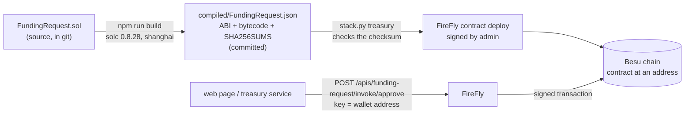

# The chain code: FundingRequest, line by line

> Companion docs: [README.md](README.md) · [tokens-explained.md](tokens-explained.md) · [wallets-explained.md](wallets-explained.md) · [use-case.md](use-case.md) · [design.md](design.md) §3
> **Where the program is:** [README.md, "Where everything is"](README.md#where-everything-is) lists every file and shows what runs where.
> Source: [contracts/treasury/contracts/FundingRequest.sol](../../contracts/treasury/contracts/FundingRequest.sol) (166 lines). You need no blockchain background; read [tokens-explained.md](tokens-explained.md) first if "mint" and "burn" are new.

**Short answer.** "Chain code" is the program that runs **on the chain**: here one Solidity contract, `FundingRequest`, running inside the Besu network at one address. Its source is `contracts/treasury/contracts/FundingRequest.sol`; once deployed it lives at one address on the chain (`funding-request` in `deployed-addresses.json`). It is the rule book and the memory of the funding flow. It stores each request and its state, it decides who may take each step, and it is the only thing that can mint or burn `CADC` and `GBPC`. The web page, the FireFly server and the treasury service only *ask* it to do things; **the contract decides**.

**Contents:** [1. What chain code is](#1-what-chain-code-is) · [2. Where it lives and how it is called](#2-where-it-lives-and-how-it-is-called) · [3. What it stores and who may do what](#3-what-it-stores-and-who-may-do-what) · [4. The code, line by line](#4-the-code-line-by-line) · [5. Why each rule exists](#5-why-each-rule-exists) · [6. Reading it from outside](#6-reading-it-from-outside) · [7. How it is tested](#7-how-it-is-tested) · [8. Changing it safely](#8-changing-it-safely)

---

## 1. What chain code is

| Idea | Here |
|---|---|
| **Smart contract / chain code** | A program stored on the blockchain. Anyone can call its functions; the network runs them the same way on every node and records the result. In Hyperledger Fabric the same idea is called "chaincode"; on Besu (an Ethereum client) it is a "smart contract" |
| **Language** | Solidity. Compiled to bytecode and run by the EVM (the Ethereum virtual machine) inside Besu |
| **State** | The values the contract remembers between calls (the requests). Stored on the chain, so every node agrees on them |
| **Transaction** | A signed call that changes state. It is mined into a block. If any `require` fails, the whole transaction is undone, as if it never ran |
| **Read call** | A `view` function. It only reads, needs no signature, changes nothing |
| **Event** | A note written to the log for outside tools. The contract cannot read its own events |

There is no server behind it and no database. If every web page and app disappeared, the contract and its state would still be on the chain, and anyone with a wallet could still call it.

## 2. Where it lives and how it is called



- **Compiled once, committed.** `contracts/treasury/compiled/FundingRequest.json` holds the **ABI** (the list of functions and their inputs) and the **bytecode** (the machine code). `SHA256SUMS` next to it is checked every time the file is loaded, so the code that runs on the chain is the code that was tested.
- **Deployed by FireFly.** `python scripts/stack.py treasury` sends the bytecode through FireFly's deploy API, signed by `admin`, with the constructor values (lines 48 to 73). The address goes into `deployed-addresses.json` under `funding-request`.
- **Called through a FireFly contract API** named `funding-request`. Each function becomes a URL: `.../apis/funding-request/invoke/approve` for a write, `.../query/getRequest` for a read. FireFly passes inputs **by name**, which is why every input in this contract has a name.
- **Signed by FireFly, not by the app.** The request body names the wallet (`"key": "0x..."`); FireFly's signer holds the keys. See [wallets-explained.md](wallets-explained.md).

## 3. What it stores and who may do what

The contract keeps one **Request** per id, and a list of all ids.

| Field | Meaning |
|---|---|
| `requester` | The wallet that asked. Also the one that receives the GBP and redeems it |
| `processingDate` | The requester's local date, as a number like `20261018` |
| `status` | `None`, `Requested`, `Approved`, `Rejected`, `Settled`, `Redeemed` |
| `amountCad` | What was asked, in cents (`100000` = 1000.00) |
| `amountGbp` | What was paid, in pence. `0` until `Settled` |
| `ratePpm` | The rate used, in parts per million (`580000` = 0.580000). `0` until `Settled` |
| `approver` | The wallet that approved or rejected. Empty before |

Who may call what (roles are fixed when the contract is deployed):

| Function | Who | From state | To state | Tokens |
|---|---|---|---|---|
| `createRequest` | a requester (`ldn`) | none | `Requested` | none |
| `approve` | an approver (`tor`), not the requester | `Requested` | `Approved` | **mint** CADC to the treasury |
| `reject` | an approver, not the requester | `Requested` | `Rejected` | none |
| `settle` | the treasury wallet only | `Approved` | `Settled` | **burn** CADC, **mint** GBPC |
| `redeem` | the requester only | `Settled` | `Redeemed` | **burn** GBPC |

## 4. The code, line by line

### Lines 1 to 12: header, the helper interface, the description

```solidity
 1  // SPDX-License-Identifier: UNLICENSED
 2  pragma solidity 0.8.28;
 3
 4  interface ICurrency {
 5      function mint(address to, uint256 amount) external;
 6      function burn(address from, uint256 amount) external;
 7  }
 8
 9  /// Cross-border branch funding: a request is created, approved (mints CADC to the treasury),
10  /// settled (burns CADC, mints GBPC at a recorded rate) and redeemed (burns GBPC).
11  /// Roles are fixed at deployment. Amounts are minor units (2 decimals), rates are parts per million.
12  /// Reverts use plain strings: FireFly's error text carries only Error("...") reasons.
```

| Line | What it does |
|---|---|
| 1, 2 | Licence note and the exact compiler version, as in the token |
| 4 to 7 | An **interface**: a promise about the shape of another contract, with no code. It says "whatever is at this address has `mint` and `burn` like this". `FundingRequest` uses it to call the two tokens without importing their code. Line 5 and 6 match `CurrencyToken` exactly |
| 9 to 12 | Comments. Line 11 introduces two number conventions you will meet below: **minor units** (cents, pence) and **parts per million** (`580000` means 0.58, because `580000 / 1,000,000`) |

### Lines 13 to 24: the states and the Request record

```solidity
13  contract FundingRequest {
14      enum Status { None, Requested, Approved, Rejected, Settled, Redeemed }
15
16      struct Request {
17          address requester; // also the beneficiary
18          uint32 processingDate; // yyyymmdd of the requester's local date
19          Status status;
20          uint256 amountCad;
21          uint256 amountGbp; // 0 until Settled
22          uint32 ratePpm; // 0 until Settled
23          address approver; // set on approve or reject
24      }
```

| Line | What it does |
|---|---|
| 13 | Opens the contract |
| 14 | An **enum**: a fixed list of named choices, stored as numbers `0` to `5` in this order. `None` is first on purpose: a request that does not exist reads as `0` = `None`, because every unset value in Solidity is 0. That is how the code tells "no such request" apart from a real one |
| 16 to 24 | A **struct**: a record with named fields, like a row. The fields are explained in the table in section 3. `uint32` is a whole number of 32 bits (enough for a date like 20261018 and a rate up to about 4,294 times) |

### Lines 26 to 34: constants and values fixed at deployment

```solidity
26      uint256 public constant RATE_SCALE = 1_000_000;
27      uint256 public constant MAX_REASON_LENGTH = 140;
28
29      ICurrency public immutable cadc;
30      ICurrency public immutable gbpc;
31      address public immutable treasury;
32      uint256 public immutable maxAmountCad;
33      uint32 public immutable minRatePpm;
34      uint32 public immutable maxRatePpm;
```

| Line | What it does |
|---|---|
| 26 | The divisor for rates: a rate of `580000` means `580000 / 1,000,000`. `_` in a number is only for reading. `constant` is baked into the code |
| 27 | The longest rejection reason, in bytes |
| 29, 30 | The two token contracts, as `ICurrency` so the code can call `mint` and `burn` on them. `immutable` = set once in the constructor, never changed. `public` creates a free read function (`cadc()`, `gbpc()`), which the deploy check uses to confirm the wiring |
| 31 | The treasury wallet: the only address allowed to `settle`. Also where approved CADC is minted to |
| 32 | The largest CAD amount in one request (`100000000` = 1,000,000.00) |
| 33, 34 | The smallest and largest rate `settle` accepts (`400000` = 0.40 to `800000` = 0.80). A safety net against a typo in the FX file: a real CAD to GBP rate is about 0.55 to 0.60, so `0.90` or `0.058` is refused |

### Lines 36 to 40: what is stored

```solidity
36      mapping(address => bool) private requesters;
37      mapping(address => bool) private approvers;
38
39      mapping(bytes32 => Request) private requests;
40      bytes32[] private ids;
```

| Line | What it does |
|---|---|
| 36, 37 | Two yes/no tables: is this address a requester? an approver? Filled in the constructor and **never changed afterwards**; there is no function to add a role. `private` keeps them out of the automatic getters (see lines 133 to 139 for the named ones) |
| 39 | **All the requests**, keyed by id. `bytes32` is 32 bytes; the app makes the id from a UUID (`0x0000...` plus the UUID's 16 bytes) |
| 40 | The ids in the order they were created, so the app can list them with `requestCount` and `requestIdAt` (a mapping cannot be listed) |

### Lines 42 to 46: events

```solidity
42      event Requested(bytes32 indexed id, address indexed requester, uint256 amountCad, uint32 processingDate);
43      event Approved(bytes32 indexed id, address indexed approver, uint256 amountCad);
44      event Rejected(bytes32 indexed id, address indexed approver, string reason);
45      event Settled(bytes32 indexed id, uint256 amountCad, uint256 amountGbp, uint32 ratePpm);
46      event Redeemed(bytes32 indexed id, address indexed beneficiary, uint256 amountGbp);
```

One event per step. They are the audit trail: `Settled` carries the CAD amount, the GBP amount **and the rate**, so the exact conversion is on the chain forever, even if the FX file changes later. `indexed` fields can be searched for. `Rejected` carries the reason text.

### Lines 48 to 73: the constructor

```solidity
48      constructor(
49          address cadc_,
50          address gbpc_,
51          address treasury_,
52          address[] memory requesters_,
53          address[] memory approvers_,
54          uint256 maxAmountCad_,
55          uint32 minRatePpm_,
56          uint32 maxRatePpm_
57      ) {
58          require(cadc_ != address(0) && gbpc_ != address(0) && treasury_ != address(0), "BadAddress");
59          require(maxAmountCad_ > 0, "BadAmount");
60          require(minRatePpm_ > 0 && minRatePpm_ <= maxRatePpm_, "BadRate");
61          cadc = ICurrency(cadc_);
62          gbpc = ICurrency(gbpc_);
63          treasury = treasury_;
64          maxAmountCad = maxAmountCad_;
65          minRatePpm = minRatePpm_;
66          maxRatePpm = maxRatePpm_;
67          for (uint256 i = 0; i < requesters_.length; i++) {
68              requesters[requesters_[i]] = true;
69          }
70          for (uint256 i = 0; i < approvers_.length; i++) {
71              approvers[approvers_[i]] = true;
72          }
73      }
```

Runs once at deployment. The values come from the deploy plan (`src/core/treasury/plan.py`): the two token addresses, the `treasury` wallet, `[ldn]` as requesters, `[tor]` as approvers, the cap, and the rate bounds.

| Line | What it does |
|---|---|
| 48 to 57 | The inputs. The trailing `_` avoids clashing with the stored names. `address[] memory` is a list of addresses |
| 58 | None of the three addresses may be empty. A zero address would break the flow silently |
| 59 | The cap must be above zero |
| 60 | The smallest rate must be above zero and not above the largest |
| 61 to 66 | Store the settings. `ICurrency(cadc_)` tells Solidity to treat that address as a contract with `mint` and `burn` |
| 67 to 69 | Go through the list of requesters and mark each `true`. `i++` adds 1 each time round. `.length` is the list size |
| 70 to 72 | The same for approvers |

### Lines 75 to 91: createRequest (step 1)

```solidity
75      function createRequest(bytes32 id, uint256 amountCad, uint32 processingDate) external {
76          require(requesters[msg.sender], "NotRequester");
77          require(requests[id].status == Status.None, "Exists");
78          require(amountCad > 0 && amountCad <= maxAmountCad, "BadAmount");
79          require(_validDate(processingDate), "BadDate");
80          requests[id] = Request({
81              requester: msg.sender,
82              processingDate: processingDate,
83              status: Status.Requested,
84              amountCad: amountCad,
85              amountGbp: 0,
86              ratePpm: 0,
87              approver: address(0)
88          });
89          ids.push(id);
90          emit Requested(id, msg.sender, amountCad, processingDate);
91      }
```

| Line | What it does |
|---|---|
| 75 | Anyone can try; the checks decide. Inputs: the id the app made, the amount in cents, the date |
| 76 | The caller must be a requester (`ldn`). Others get `NotRequester` |
| 77 | The id must be new. `requests[id]` of an unknown id reads as all zeros, so `status` is `None`. Reusing an id gets `Exists` (this is also what protects against a double submit) |
| 78 | Above zero and not above the cap |
| 79 | The date must look like a real date (helper at line 161) |
| 80 to 88 | Writes the new record. The caller becomes the `requester`, and so the one who will receive the GBP. The GBP, rate and approver start empty |
| 89 | Adds the id to the list |
| 90 | Logs `Requested`. No token is created: asking for money creates nothing |

### Lines 93 to 99: approve (step 3, CADC is minted)

```solidity
93      function approve(bytes32 id) external {
94          Request storage r = _decidable(id);
95          r.status = Status.Approved;
96          r.approver = msg.sender;
97          emit Approved(id, msg.sender, r.amountCad);
98          cadc.mint(treasury, r.amountCad);
99      }
```

| Line | What it does |
|---|---|
| 94 | Runs the shared check (lines 153 to 159): the request is `Requested`, the caller is an approver, and the caller is not the requester. Returns a **reference** to the stored record: `storage` means "work on the real one, not a copy", so the changes on lines 95 and 96 are saved |
| 95 | Moves to `Approved` |
| 96 | Remembers who approved |
| 97 | Logs `Approved` |
| 98 | **Mints CADC** for exactly the requested amount to the treasury wallet. This is the only place CADC is created. It is the last line on purpose (see section 5, "state before tokens") |

### Lines 101 to 107: reject

```solidity
101     function reject(bytes32 id, string calldata reason) external {
102         require(bytes(reason).length <= MAX_REASON_LENGTH, "ReasonTooLong");
103         Request storage r = _decidable(id);
104         r.status = Status.Rejected;
105         r.approver = msg.sender;
106         emit Rejected(id, msg.sender, reason);
107     }
```

| Line | What it does |
|---|---|
| 101 | `calldata` means the text is read straight from the call and not copied, which is cheaper |
| 102 | The reason is at most 140 bytes. `bytes(reason).length` is the size in bytes |
| 103 to 105 | Same check and bookkeeping as `approve`, with state `Rejected` |
| 106 | Logs the reason. **No tokens move**: nothing was minted for a request that was only `Requested` |

### Lines 109 to 122: settle (step 6, CADC is burnt, GBPC is minted)

```solidity
109     function settle(bytes32 id, uint32 ratePpm) external {
110         Request storage r = requests[id];
111         require(r.status == Status.Approved, "BadState");
112         require(msg.sender == treasury, "NotTreasury");
113         require(ratePpm >= minRatePpm && ratePpm <= maxRatePpm, "BadRate");
114         uint256 gbp = (r.amountCad * ratePpm) / RATE_SCALE;
115         require(gbp > 0, "BadAmount");
116         r.status = Status.Settled;
117         r.amountGbp = gbp;
118         r.ratePpm = ratePpm;
119         emit Settled(id, r.amountCad, gbp, ratePpm);
120         cadc.burn(treasury, r.amountCad);
121         gbpc.mint(r.requester, gbp);
122     }
```

| Line | What it does |
|---|---|
| 109 | The treasury service calls this with the rate it read from the FX file |
| 110 | Finds the request, as a reference to the stored record |
| 111 | Only an `Approved` request can be settled. Settling twice, or before approval, gets `BadState` |
| 112 | Only the treasury wallet. Not the admin, not `tor` |
| 113 | The rate must be within the bounds from the constructor |
| 114 | **The conversion:** CAD cents times the rate, divided by a million. For `100000` cents at `580000`: `100000 * 580000 / 1,000,000 = 58000` pence. Whole-number division **rounds down**, so `100.01` CAD (`10001`) gives `5800` pence, not `5801`. The Python function `convert_cad_to_gbp` does exactly the same sum, and a test checks they agree |
| 115 | A result of 0 is refused (a tiny request that would convert to less than one penny), so a request can never settle to nothing |
| 116 to 118 | Save the new state, the GBP amount and the rate |
| 119 | Logs `Settled` with all three numbers |
| 120 | **Burns the CADC** minted at approval, from the treasury wallet |
| 121 | **Mints the GBPC** to the requester's wallet |

Lines 116 to 121 are one transaction. If the mint on line 121 failed, the burn on line 120 and the state change would be undone too. There is never a moment when both currencies exist for one request.

### Lines 124 to 131: redeem (step 7, GBPC is burnt)

```solidity
124     function redeem(bytes32 id) external {
125         Request storage r = requests[id];
126         require(r.status == Status.Settled, "BadState");
127         require(msg.sender == r.requester, "NotBeneficiary");
128         r.status = Status.Redeemed;
129         emit Redeemed(id, msg.sender, r.amountGbp);
130         gbpc.burn(msg.sender, r.amountGbp);
131     }
```

| Line | What it does |
|---|---|
| 126 | Only a `Settled` request, and only once |
| 127 | Only the wallet that received the GBP. `tor` or `treasury` calling it gets `NotBeneficiary` |
| 128, 129 | New state, and the log |
| 130 | **Burns the GBPC** from the requester. Meaning in business terms: the pounds have left the chain and been paid out off-chain. If the requester no longer holds that much GBPC the burn fails and the whole call is undone |

### Lines 133 to 151: read-only functions

```solidity
133     function isRequester(address account) external view returns (bool) {
134         return requesters[account];
135     }
...
141     function getRequest(bytes32 id) external view returns (Request memory) {
142         return requests[id];
143     }
145     function requestCount() external view returns (uint256) {
146         return ids.length;
147     }
149     function requestIdAt(uint256 index) external view returns (bytes32) {
150         return ids[index];
151     }
```

| Line | What it does |
|---|---|
| 133 to 139 | `isRequester` and `isApprover`: named getters for the two role tables (a `private` mapping has none; a public one would have an input with no name) |
| 141 to 143 | `getRequest`: the whole record as an object. A request that does not exist comes back with status `0` (`None`), which is how the app knows it is missing |
| 145 to 147 | How many requests exist |
| 149 to 151 | The id at position `index`, counting from 0. The app lists everything by looping from 0 to `requestCount - 1` |

All are `view`: free, no signature.

### Lines 153 to 165: the two private helpers

```solidity
153     /// A request still waiting for a decision, and the caller may decide it.
154     function _decidable(bytes32 id) private view returns (Request storage r) {
155         r = requests[id];
156         require(r.status == Status.Requested, "BadState");
157         require(approvers[msg.sender], "NotApprover");
158         require(msg.sender != r.requester, "SelfApproval");
159     }
160
161     function _validDate(uint32 d) private pure returns (bool) {
162         uint32 month = (d / 100) % 100;
163         uint32 day = d % 100;
164         return d >= 20000101 && d <= 29991231 && month >= 1 && month <= 12 && day >= 1 && day <= 31;
165     }
166 }
```

| Line | What it does |
|---|---|
| 154 | A helper only this contract can call (`private`). It returns the stored request so `approve` and `reject` can change it. Shared so the two cannot drift apart |
| 155 | Loads the record |
| 156 | It must still be waiting (`Requested`). A decided or unknown request gets `BadState` |
| 157 | The caller must be an approver |
| 158 | **Maker-checker:** the approver must not be the requester. In the live deploy `ldn` is not an approver, so it already stops at line 157 with `NotApprover`; `SelfApproval` matters if one wallet ever holds both roles (the contract tests do exactly that) |
| 161 | `pure` means it reads no state at all, only its input |
| 162 | Takes the date `20261018`: divides by 100 (`202610`) and keeps the last two digits (`10`) = the month |
| 163 | `d % 100` is the remainder after dividing by 100 = the day (`18`) |
| 164 | The year must be 2000 to 2999, month 1 to 12, day 1 to 31. This only catches nonsense such as month 13; it does not know that 31 February is wrong. The date is a label, not a trusted calendar (decision D-21) |
| 166 | Closes the contract |

## 5. Why each rule exists

| Rule (line) | What it stops | Test that proves it |
|---|---|---|
| Only requesters create (76) | A random wallet filling the list | `test_CreateRequiresTheRequesterRole` |
| New id only (77) | Two requests under one id, double submit | `test_CreateRejectsADuplicateId` |
| Cap and above zero (78) | A typo like `1000000000.00`, or `0` | `test_CreateRejectsBadAmounts` |
| Approver, not the requester (157, 158) | Paying yourself | `test_ApproveRules`, `test_ARequesterWhoIsAlsoAnApproverCannotApproveTheirOwnRequest` |
| One decision only (156) | Minting CADC twice for one request | `test_ApproveTwiceReverts` |
| Only the treasury settles (112) | A branch picking its own rate | `test_SettleRules` |
| Rate bounds (113) | A rate of `0.90`, `0.058` or `580` instead of `0.58` | `test_SettleRules` |
| Round down, never to zero (114, 115) | Creating money from rounding; settling to nothing | `test_SettleRoundsDown`, `test_SettleThatRoundsToZeroReverts`, the fuzz test |
| Only the beneficiary redeems (127) | Someone else cashing out the GBP | `test_RedeemRules` |
| **State before tokens** (95 before 98, 116 to 118 before 120, 128 before 130) | A call that re-enters the function through a token and acts on stale state. The tokens are our own code and cannot do that today, but writing "checks, then state, then outside calls" is the habit that keeps it safe if they ever change | reviewed with the `solidity-security` checklist |
| Solidity 0.8 arithmetic | Overflow and underflow wrapping silently | built into the compiler |
| Reverts are plain strings | A failure showing as "no reason given" in FireFly | the revert-message mapping tests |

## 6. Reading it from outside

All through FireFly (`http://localhost:5000/api/v1/namespaces/default`), with the stack up and `treasury` run:

```bash
# how many requests exist
curl -s -X POST .../apis/funding-request/query/requestCount -H 'Content-Type: application/json' -d '{}'
# {"output": "3"}

# one request, by id (the 0x00..00 plus 16 bytes of the UUID)
curl -s -X POST .../apis/funding-request/query/getRequest -H 'Content-Type: application/json' \
  -d '{"input": {"id": "0x0000000000000000000000000000000000000000000000000000000000000001"}}'
# {"output": {"amountCad": "0", "amountGbp": "0", "approver": "0x000...", "processingDate": "0",
#             "ratePpm": "0", "requester": "0x000...", "status": "0"}}   <- status 0 = does not exist
```

`status` numbers: `1` Requested, `2` Approved, `3` Rejected, `4` Settled, `5` Redeemed. In the FireFly Explorer (`/ui`, Blockchain, Operations) each write shows as an operation named `createRequest`, `approve`, `reject`, `settle` or `redeem`, with the transaction and the signer.

## 7. How it is tested

| Layer | Where | What |
|---|---|---|
| Contract tests | `contracts/treasury/test/*.t.sol`, run by `cd contracts/treasury && npm test` | 35 tests (11 for the token, 21 for this contract, 3 for atomicity): every success and every revert in the table of section 5, plus a fuzz test that tries random amounts and rates and checks the conversion formula and that CADC and GBPC supplies follow the four stages |
| Mutation check | done by hand | Seven deliberate bugs (remove the self-approval check, remove the treasury check, round up instead of down, remove the CADC burn, let anyone mint, and hide a failing GBPC mint or CADC mint with `try`/`catch`) were each caught by a failing test. The last two are why the atomicity tests exist: see [middleman-and-atomicity.md](middleman-and-atomicity.md) |
| Python mirror | `tests/unit/core/test_treasury_*.py` | The same state machine and conversion in Python, so the app and the contract cannot disagree silently |
| Live | `tests/integration/test_treasury_flow.py` | 17 tests through FireFly on a real chain, including direct calls that bypass the web page to prove the **chain** refuses |

## 8. Changing it safely

1. Edit the `.sol` file. Update or add a test in `contracts/treasury/test/` first and watch it fail.
2. `cd contracts/treasury && npm test`, then `npm run build`. The build rewrites `compiled/` and `SHA256SUMS`.
3. Commit the source **and** `compiled/` together. A unit test fails if `compiled/` and `SHA256SUMS` disagree, but nothing checks that `compiled/` matches the source: running `npm run build` after every edit is what keeps them in step.
4. A deployed contract cannot be edited. A change means a new address: `python scripts/stack.py reset`, then `up`, `deploy`, `treasury`. In a real system you would need a migration plan for the requests already on the old contract.
5. **Roles are fixed at deployment** (lines 36, 37, 67 to 72). Adding a branch or an approver means a new deploy, or adding a role-management function first. That is a deliberate choice to keep v1 small: fewer functions, fewer ways to go wrong. See [wallets-explained.md](wallets-explained.md), section 6.
