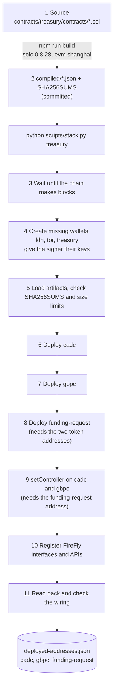
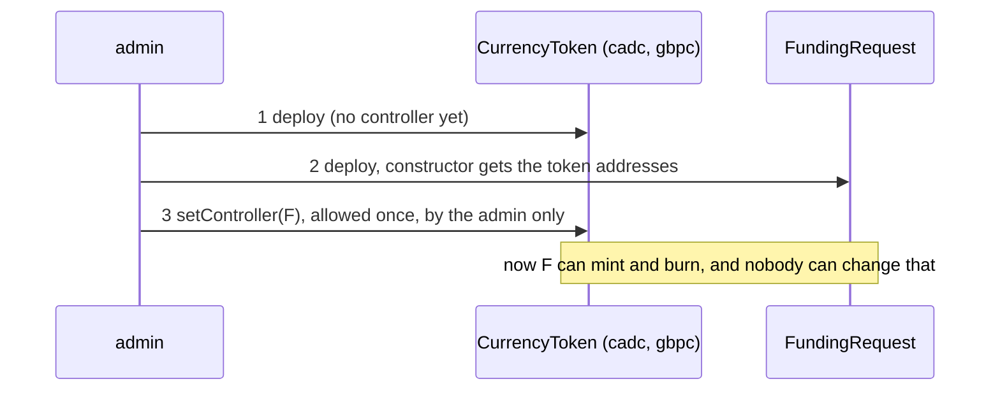

# Deployment: the currencies, the smart contracts and the chain code

> Companion docs: [README.md](README.md) · [tokens-explained.md](tokens-explained.md) · [chaincode-explained.md](chaincode-explained.md) · [wallets-explained.md](wallets-explained.md) · [middleman-and-atomicity.md](middleman-and-atomicity.md)
> Everything below was run on the live stack, and the command output shown is real. You need no blockchain background.

**Short answer.** One command, `python scripts/stack.py treasury`, deploys everything: it makes the wallets, deploys **three contracts** through FireFly (`cadc`, `gbpc`, `funding-request`), wires them together, registers a FireFly API for each, and checks the result. Running it again changes nothing. "Deploying a currency" and "deploying the chain code" are not separate jobs here; they are different steps of the same plan.

**Contents:** [1. Three words, one thing](#1-three-words-one-thing) · [2. What gets deployed](#2-what-gets-deployed) · [3. The pipeline](#3-the-pipeline) · [4. Deploying a currency](#4-deploying-a-currency) · [5. Deploying the contract logic](#5-deploying-the-contract-logic-the-chain-code) · [6. The safety checks](#6-the-safety-checks) · [7. Run it, and check it](#7-run-it-and-check-it) · [8. Redeploying, resetting, upgrading](#8-redeploying-resetting-upgrading) · [9. When it goes wrong](#9-when-it-goes-wrong) · [10. For a real system](#10-for-a-real-system)

---

## 1. Three words, one thing

| Word | What it means in this project | Deployed as |
|---|---|---|
| **Currency** | A token whose balances stand for money: `CADC` (Canadian dollars) and `GBPC` (pounds). A currency is **an instance**: the same code deployed once per currency, with its own name, symbol and ledger | Two deployments of `CurrencyToken.sol`, named `cadc` and `gbpc` |
| **Smart contract** | A program stored on the chain at an address. The word covers all three deployments here | Three contracts in total |
| **Chain code** | The program that holds the *business rules* on the chain. On Besu this is also a smart contract; "chaincode" is the Hyperledger Fabric word for the same idea. Here it means `FundingRequest`: the requests, the roles, the state machine, and the right to mint and burn | One deployment of `FundingRequest.sol`, named `funding-request` |

So: **2 sources, 3 deployments**. The two currencies are one source deployed twice; the chain code is the second source deployed once. (If by "chaincode" you meant something else, see section 5, which also compares with Fabric.)

## 2. What gets deployed

| # | Name | Source | Constructor arguments | Size (init / runtime) |
|---|---|---|---|---|
| 1 | `cadc` | `CurrencyToken.sol` | `"Canadian Dollar Coin"`, `"CADC"`, the `admin` address | 3,591 / 2,771 bytes |
| 2 | `gbpc` | `CurrencyToken.sol` | `"Pound Sterling Coin"`, `"GBPC"`, the `admin` address | 3,591 / 2,771 bytes |
| 3 | `funding-request` | `FundingRequest.sol` | the `cadc` and `gbpc` addresses, the `treasury` wallet, `[ldn]` as requesters, `[tor]` as approvers, the cap `100000000` (CAD 1,000,000.00), the lowest rate `10000` (0.01), the highest `5000000` (5.00) | 5,830 / 4,698 bytes |

Then two wiring calls, and the FireFly registration:

| Step | Call | Signed by |
|---|---|---|
| 4 | `cadc.setController(funding-request)` | `admin` |
| 5 | `gbpc.setController(funding-request)` | `admin` |
| 6 | register a FireFly **contract interface** and **contract API** for `cadc`, `gbpc` and `funding-request` | no signature (a FireFly record, not a transaction) |

Every transaction is signed by `admin` (FireFly signs; the key is not in the app). The plan itself is data in [src/core/treasury/plan.py](../../src/core/treasury/plan.py); the code that runs it is the T-REX plan runner `run_plan` in [src/adapters/trex_deploy.py](../../src/adapters/trex_deploy.py), shared with the `COIN` deployment.

## 3. The pipeline



What each step does and which file does it:

| Step | What happens | Code |
|---|---|---|
| 1 and 2 | Build once, **by a developer**, and commit the compiled files. Deploying never compiles | `contracts/treasury/package.json` (`npm run build`), `scripts/export-artifacts.mjs` |
| 3 | `wait_for_chain`: wait until the RPC node reports blocks. The RPC node joins the validator some time after it starts; a transaction sent earlier is never mined | `src/adapters/rpc.py` |
| 4 | `ensure_wallets`: add the three wallets to `wallets.json` if missing, write keystores, restart the signer if it does not list them. See [wallets-explained.md](wallets-explained.md) §2 | `src/adapters/treasury_deploy.py` |
| 5 | `load_treasury_artifact`: refuse a file whose SHA-256 does not match `SHA256SUMS`; the test suite also checks both sizes against the chain's limits | `src/adapters/treasury_artifacts.py` |
| 6 to 8 | For each deploy: skip if the name is already in `deployed-addresses.json` **and** that address still has code; otherwise send the bytecode and constructor arguments through FireFly's deploy API as `admin`, wait for success, check the new address has code, and **save the address at once** | `run_plan` |
| 9 | The two `setController` calls, as ordinary FireFly invokes | `run_plan` |
| 10 | `register_treasury_apis`: create (or reuse) a contract interface and a contract API per contract | `treasury_deploy.py` |
| 11 | `check_wiring`: read `controller()` of both tokens, and `treasury()`, `cadc()`, `gbpc()` of the request contract, and fail if any is not what was meant | `treasury_deploy.py` |

## 4. Deploying a currency

A currency is created in three moves. Only the first two are in the contract's own code:

1. **Deploy `CurrencyToken`** with a name, a symbol and the admin. The ledger starts **empty**: supply 0, no one holds anything. There is no initial mint, on purpose.
2. **Set the controller once**, from the admin, to the `FundingRequest` address. From then on only that contract can mint or burn, and the admin has no power over the money.
3. **Register it in FireFly** so the app and the Explorer can call it by name (`cadc`).

The currency exists as money only when the flow mints it: CADC at `approve`, GBPC at `settle`.

### Adding a third currency (for example `EURC`)

| Part | What to do | The catch |
|---|---|---|
| The token | Add `Deploy("eurc", TOKEN_ARTIFACT, ("Euro Coin", "EURC", Account("admin")))` and a `setController` call to the plan, with a FireFly API name | None: the same source is reused, no recompile |
| The rules | `FundingRequest` knows exactly two tokens, fixed in its constructor (`cadc`, `gbpc`). It has no idea of EUR | A third currency needs either **a new `FundingRequest`** for the new pair (a copy of the request contract wired to different tokens, and a way to tell which one a request belongs to), or a **redesigned contract** that handles a list of currencies |
| The controller | Each token's controller can be set only once | A token can serve **only one** request contract. The new pair needs its own tokens, or the old controller cannot be changed |
| The rate table | `fx-rates.json` has only `CADGBP` | Add the pair, and teach the code the new pair name. Today the parser reads exactly `CADGBP` |

So adding a currency is cheap on the token side and a real design task on the rules side.

## 5. Deploying the contract logic (the chain code)

**An ordering puzzle, and how it is solved.** The request contract needs the token addresses when it is built. The tokens need the request contract's address to name it as their controller. Neither can come first. The solution is in the contracts:



The tokens start with **no controller** and the admin sets it afterwards, exactly once.

**What is fixed at this moment** (it cannot be changed later; see [wallets-explained.md](wallets-explained.md) §6):

| Fixed at deploy | Value in this project |
|---|---|
| Which tokens | `cadc`, `gbpc` |
| Who may create requests | `ldn` |
| Who may approve | `tor` |
| Who settles | `treasury` |
| The cap per request | CAD 1,000,000.00 |
| The rate bounds | 0.01 to 5.00 |
| The code | the compiled bytecode, never edited |

**Comparison with Hyperledger Fabric chaincode**, in case that is the picture in your head:

| | Fabric chaincode | This project (Besu, EVM) |
|---|---|---|
| Unit | A chaincode package, installed on each organisation's peers | A contract's bytecode, stored **on the chain** itself |
| Approval to deploy | Each organisation approves the definition, then one commits it | Whoever signs the deploy transaction. Here `admin`; no per-organisation vote |
| Where it runs | In a separate chaincode container (or process) next to each peer | Inside every node's EVM, as part of processing the block |
| Name | Chaincode name and version | An **address**, new for every deployment |
| Upgrade | Redefine with a new version; the data stays in the channel | None for this code: new code is a new address, and old state does not move |
| Data | World state of the channel | The contract's own storage |

## 6. The safety checks

| Check | What it stops |
|---|---|
| **Checksum on load** | A compiled file that was edited, or that is not the one committed. The deploy refuses with `ChecksumError` |
| **Size limits** (a unit test) | Code the chain would refuse: a runtime limit of 24,576 bytes and an init limit of 49,152. Ours are about 4.7 KB and 5.8 KB at most |
| **Deploy is skipped if the address is known and has code** | A second contract at a new address on every run |
| **Idempotency keys** `trex-cadc`, `trex-gbpc`, `trex-funding-request`, `trex-cadc-setController`, ... | The same write sent twice (a retry after a timeout). FireFly answers "already submitted"; the runner waits until the first attempt is final and uses its result |
| **Retry rules** | A dropped connection or timeout is retried up to 3 times with the same key. If the earlier attempt **failed**, it is retried under a new, stable key, up to 3 times. An earlier attempt still pending after 180 seconds stops the run with a clear message |
| **Code at the address** | A reported address with no code is an error, not a success |
| **Save after every deploy** | A crash half-way keeps what was done; the next run continues |
| **Wiring check** | A contract that deployed but is pointed at the wrong thing |
| **Only `admin` can set the controller, once** | Someone taking over the minting right after deploy |

## 7. Run it, and check it

**Needs:** Docker running; the stack up and the T-REX deploy done (`python scripts/stack.py up` then `deploy`).

```text
$ python scripts/stack.py treasury
cadc  0x01fc7b7feb7492e69b2a6aaa36958591743a3269
gbpc  0x1933c75c79ce39e962eff868d71ff161de7dc599
funding-request  0x2433e797229a8640c80070fbc8ec695add46d738
cadc.setController
gbpc.setController
api cadc  0x01fc7b7feb7492e69b2a6aaa36958591743a3269
api gbpc  0x1933c75c79ce39e962eff868d71ff161de7dc599
api funding-request  0x2433e797229a8640c80070fbc8ec695add46d738
treasury  wired
```

(The addresses differ on every fresh chain.) Run it again:

```text
cadc  0x01fc...  (already deployed)
gbpc  0x1933...  (already deployed)
funding-request  0x2433...  (already deployed)
cadc.setController  (already done)
gbpc.setController  (already done)
api cadc  0x01fc...
api gbpc  0x1933...
api funding-request  0x2433...
treasury  wired
```

The second run sent **no transaction**: the admin wallet's transaction count was the same before and after (checked with `eth_getTransactionCount`; the integration test `test_treasury_deploy_is_idempotent` does this).

**Check by hand** (the stack up):

```bash
# the addresses written
cat deployed-addresses.json

# the code really is on the chain (a non-empty result, not "0x")
curl -s -X POST localhost:8545 -H 'Content-Type: application/json' \
  -d '{"jsonrpc":"2.0","id":1,"method":"eth_getCode","params":["<funding-request address>","latest"]}'

# the wiring: the controller of cadc is the request contract
curl -s -X POST http://localhost:5000/api/v1/namespaces/default/apis/cadc/query/controller \
  -H 'Content-Type: application/json' -d '{}'
# the treasury wallet the contract was built with
curl -s -X POST http://localhost:5000/api/v1/namespaces/default/apis/funding-request/query/treasury \
  -H 'Content-Type: application/json' -d '{}'
```

In the FireFly Explorer (`http://localhost:5000/ui`): Blockchain, Operations includes three `contract deploy` operations for these contracts and two `setController` invokes, all signed by the admin address; Blockchain, Contract APIs lists `cadc`, `gbpc`, `funding-request`.

## 8. Redeploying, resetting, upgrading

| You want to | What to do | What happens to the data |
|---|---|---|
| Run the command again | `python scripts/stack.py treasury` | Nothing changes |
| Start from a clean chain | `python scripts/stack.py reset`, then `up`, `deploy`, `treasury` | **Everything is gone**: the chain, the addresses, every request. The demo keeps no volumes (plan decision D-11). The wallets stay: `wallets.json` and the signer's keystore files are not touched by `reset`, so the same three addresses are used again (a missing keystore is rebuilt) |
| Change a `.sol` file | Edit, update the tests, `cd contracts/treasury && npm test`, `npm run build`, commit `compiled/` with it, then `reset` and redeploy | New addresses. The old contracts and their requests stay on the old chain, if you keep it |
| Change a role, the cap or a rate bound | Same as a code change: they are constructor arguments | New contract, new tokens (their controller is set once) |
| Change the FX rates | Edit `network-config/treasury/fx-rates.json` | **No deploy.** The file is read at every settlement. This is why the rate is not in the contract |
| Rebuild only the compiled files | `npm run build` | The checksum file changes with them. Commit both |

**An important property:** a deployed contract is **immutable**. There is no "update". Every change to the rules is a new contract at a new address, and requests do not move across. In this demo that is free because `reset` wipes the chain anyway. Anywhere else it needs a migration plan (section 10).

## 9. When it goes wrong

| What you see | Cause | Fix |
|---|---|---|
| `error: ... not found. Run npm run build in contracts/treasury/ and commit compiled/` | `compiled/` is missing (a partial checkout) | `cd contracts/treasury && npm ci && npm run build` |
| `ChecksumError: ... does not match SHA256SUMS` | A compiled file was edited or only half rebuilt | Rebuild with `npm run build` and commit both |
| The command waits a long time at the start | The RPC node is not producing or following blocks yet | It waits up to 180 s. Check `docker ps` and `curl localhost:8545` |
| `the signer did not list ... within 60s of restarting` | `firefly-signer` did not start or cannot read a keystore | `docker logs firefly-signer`; check `network-config/firefly/signer-data/` |
| `funding-request: ...` or `cadc: ...` with an HTTP error text | FireFly or the chain refused the transaction | Read the text; check `docker logs firefly-core` and `firefly-evmconnect` |
| `... is still pending after 180s` | An earlier attempt did not finish | Wait and run again; it continues from what finished |
| `cadc.controller: should be 0x..., it is ...` | The wiring is not what was meant (a mixed-up chain from old runs) | `reset` and redeploy |
| `... has no code on chain` | A recorded address no longer has code (the chain was reset but `deployed-addresses.json` was kept) | Delete `deployed-addresses.json` or run `reset`, which removes it |
| `PlanError: unknown account ...` | The plan names a wallet that is not allowed for this plan | Check `src/core/treasury/plan.py` |

## 10. For a real system

This deployment is a **demo**: one deployer key in a file, no review gate, a chain that is wiped. For anything real:

| Today | Real life |
|---|---|
| `admin` is a key in git | A hardware wallet or a key-management service; the deploy runs from a controlled pipeline |
| One person's command | Two-person approval of every deploy, and the compiled hash recorded in the release |
| Immutable contract, `reset` for changes | An upgrade design (a proxy, or a registry that names the current contract) and a migration of open requests |
| Roles fixed at deploy | A role-management function, with its own approvals and tests |
| `treasury` is one wallet | A treasury system with limits and monitoring |
| Checks by one command | The deployed bytecode compared on-chain with the reviewed build, source published to a verifier, and an external audit of both contracts |
| No staging | The same plan on a test network first, with the same integration tests |

[../production-step-by-step.md](../production-step-by-step.md) discusses the wider path.
