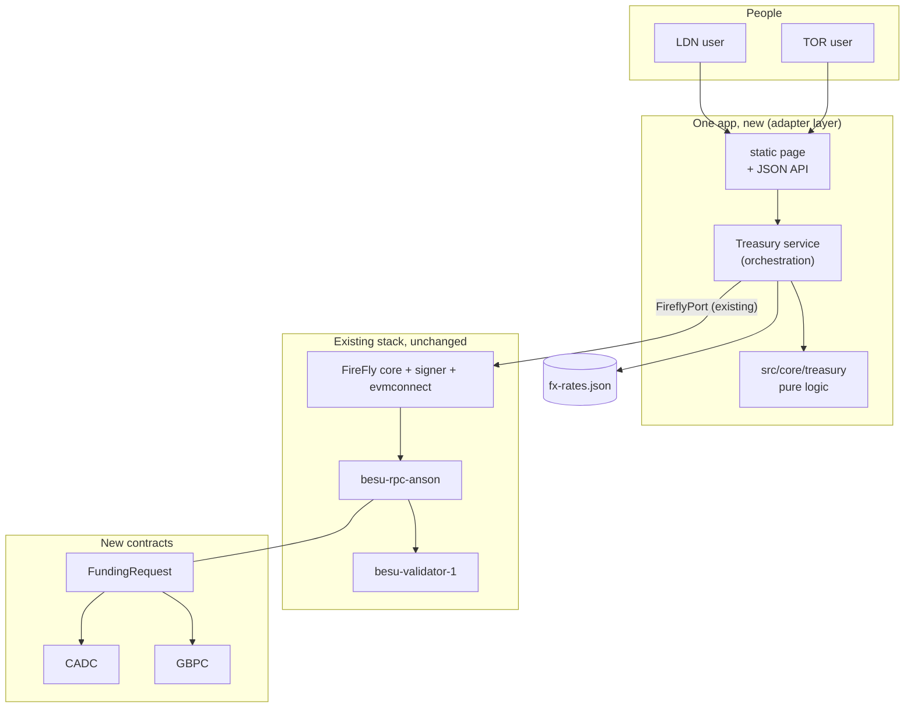
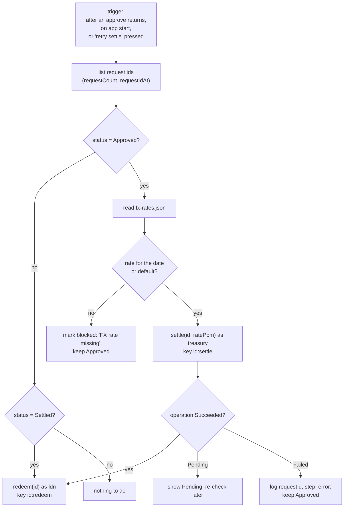

# Design: Treasury branch funding

> Companion docs: [README.md](README.md) · [use-case.md](use-case.md) · [prd.md](prd.md) · [tasks.md](tasks.md) · [test-plan.md](test-plan.md)
> Based on: `docs/architecture.md` (layers, write lifecycle, failure handling), `docs/plan.md` (D-01 to D-17), `docs/wallets.md`.

## 1. Context



The single RPC node and single FireFly in your assumption are what the repo already has (D-17), so nothing in the network changes.

## 2. Layering (CLAUDE §10, PROJECT.md)

| Layer | New files | Rule |
|---|---|---|
| `src/core/treasury/` | `money.py` (parse and format minor units), `fx.py` (rate table, lookup, conversion), `request.py` (state, transitions, validation), `dates.py` (processing date from a clock and a zone), `ids.py` (request id to `bytes32`, idempotency key), `ledger.py` (conservation check), `errors.py` | Pure. No `print`, `input`, network, file or clock access: the clock and the rate table are passed in |
| `src/core/firefly/` | none | The existing `FireflyPort`, `outcome` and error model are reused as they are |
| `src/core/treasury/` (also) | `plan.py` (deploy plan), `gateway.py` (who signs which write, idempotency keys, reading a request, balances), `service.py` (steps 5 to 7: settle `Approved`, redeem `Settled`), `messages.py`, `views.py` | Pure: the FireFly port, the rate-table reader and the log sink are passed in |
| `src/adapters/` | `treasury_artifacts.py` (loads `compiled/`, checks `SHA256SUMS`), `treasury_deploy.py` (wallets, deploy, register, wiring check), `treasury_api.py` (routes, no sockets), `treasury_http.py` (server, the page's files, the guards), `treasury_app.py` (puts it together, reads `fx-rates.json`), `treasury_ui/` (page) | I/O only; calls core |
| `scripts/` | `treasury_app.py` (entry point that starts the HTTP server); `stack.py treasury` is a new command of the existing script | Thin |
| `contracts/treasury/` | `contracts/*.sol`, `test/*.t.sol` (Hardhat 3 Solidity tests), `compiled/` (committed ABI, bytecode and `SHA256SUMS`) | Compiled once, committed like `contracts/paladin/` |
| `tests/unit/core/test_treasury_*.py` (flat, as the rest of `tests/unit/core`), `tests/unit/adapters/`, `tests/integration/test_treasury_*.py` | | Mirror the code |

## 3. Contracts

### 3.0 Inventory: what this use case adds

| Item | Count | Which |
|---|---|---|
| Solidity source files | 2 | `CurrencyToken.sol`, `FundingRequest.sol` |
| Deployed contracts | 3 | `CADC`, `GBPC` (the same source twice), `FundingRequest` |
| ERC-20 tokens | 2 | `CADC`, `GBPC` (`COIN` is unchanged) |
| Logical ledgers on the one Besu chain | 3 | `CADC` (CAD balances), `GBPC` (GBP balances), `FundingRequest` (the state, amounts and rate of every request). With `COIN` the chain has 4 |
| Private ledgers (Paladin Noto) | 0 | none, see TD-01 |
| New wallets | 3 | `ldn`, `tor`, `treasury` (`admin` already exists) |
| Contract interfaces and contract APIs registered in FireFly | 3 each | one per deployed contract |

**Who mints and burns:** no wallet does, and none is created for it. Only the `FundingRequest` contract address is the `controller` of both tokens (TD-02). Wallets trigger it through their role: `tor` through `approve` (mints CADC), `treasury` through `settle` (burns CADC, mints GBPC), `ldn` through `redeem` (burns GBPC). `admin` deploys and sets the roles but cannot mint. A separate minter wallet would add a key that can mint with no request or approval, which defeats maker-checker.

### 3.1 `CurrencyToken` (deployed twice: `CADC`, `GBPC`)

A minimal ERC-20 (balances, transfers, `totalSupply`, 2 decimals) with one extra rule: `mint(to, amount)` and `burn(from, amount)` are callable only by a single `controller` address. `controller` is set once by the admin after `FundingRequest` is deployed and cannot change again (TD-02). Plain transfers between holders are allowed (it is an ERC-20) but the flow never uses them.

> `burn(from, amount)` by the controller needs no allowance. This is the key trust point: only `FundingRequest` can reach it, and it only burns from the treasury wallet (CADC) or the beneficiary (GBPC) of a request in the right state.

### 3.2 `FundingRequest`

```solidity
enum Status { None, Requested, Approved, Rejected, Settled, Redeemed }

struct Request {
    address requester;      // also the beneficiary
    uint32  processingDate; // yyyymmdd of the requester's local date
    Status  status;
    uint256 amountCad;      // minor units
    uint256 amountGbp;      // 0 until Settled
    uint32  ratePpm;        // 0 until Settled, GBP per 1 CAD x 1,000,000
    address approver;       // set on approve or reject
}

// roles: fixed in the constructor (no role-management functions in v1, fewer ways to go wrong)
mapping(address => bool) requesters;   // ldn
mapping(address => bool) approvers;    // tor
address public treasury;               // the treasury wallet
uint256 public immutable maxAmountCad; // cap, default 100000000 (CAD 1,000,000.00)
uint32  public immutable minRatePpm;   // sanity bounds on the rate
uint32  public immutable maxRatePpm;

function createRequest(bytes32 id, uint256 amountCad, uint32 processingDate) external;
function approve(bytes32 id) external;                  // mints CADC to treasury
function reject(bytes32 id, string calldata reason) external;
function settle(bytes32 id, uint32 ratePpm) external;   // burn CADC, mint GBPC
function redeem(bytes32 id) external;                   // burn GBPC
function getRequest(bytes32 id) external view returns (Request memory);
function requestCount() external view returns (uint256);
function requestIdAt(uint256 index) external view returns (bytes32);

event Requested(bytes32 indexed id, address indexed requester, uint256 amountCad, uint32 processingDate);
event Approved(bytes32 indexed id, address indexed approver, uint256 amountCad);
event Rejected(bytes32 indexed id, address indexed approver, string reason);
event Settled(bytes32 indexed id, uint256 amountCad, uint256 amountGbp, uint32 ratePpm);
event Redeemed(bytes32 indexed id, address indexed beneficiary, uint256 amountGbp);
```

**Rules inside each function** (checks, then state change, then the token call):

| Function | Checks (revert reason) | Effect |
|---|---|---|
| `createRequest` | caller is a requester (`NotRequester`); id unused (`Exists`); `0 < amount ≤ max` (`BadAmount`); date plausible, 2000-01-01 to 2999-12-31 (`BadDate`) | store, `Requested` |
| `approve` | status `Requested` (`BadState`); caller is an approver (`NotApprover`); caller ≠ requester (`SelfApproval`) | status `Approved`, `CADC.mint(treasury, amountCad)` |
| `reject` | same as `approve`; reason length ≤ 140 (`ReasonTooLong`) | status `Rejected` |
| `settle` | status `Approved` (`BadState`); caller is `treasury` (`NotTreasury`); `min ≤ rate ≤ max` (`BadRate`) | compute `gbp = amountCad × rate / 1e6` (floor), status `Settled`, `CADC.burn(treasury, amountCad)`, `GBPC.mint(requester, gbp)` |
| `redeem` | status `Settled` (`BadState`); caller is `requester` (`NotBeneficiary`) | status `Redeemed`, `GBPC.burn(requester, amountGbp)` |

If `gbp` rounds to 0 the call reverts (`BadAmount`), so a request can never settle to nothing.

**Revert reasons are strings.** Each check is `require(cond, "NotApprover")`, not a Solidity custom error, because FireFly's error text carries only `Error("...")` reasons and the existing `revert_reason` reads only those. A custom error would reach the UI as "no reason given".

**Security checklist** (use the `solidity-security` skill at review): state is changed before the token calls; the tokens are our own code, so reentrancy is not reachable, and the order is still checks-effects-interactions; Solidity ≥ 0.8 checked arithmetic; no `tx.origin`; no unbounded loops in writes (`requestIdAt` is a view); roles are not transferable by users.

## 4. FireFly usage

| Step | FireFly call | Signer (`key`) | `idempotencyKey` |
|---|---|---|---|
| deploy | contract deploy API, three contracts (like T-REX in UC-04) | `admin` | n/a, deploy is skipped if the address is already in `deployed-addresses.json` |
| register | contract interface + contract API per contract (reuses `ensure_interface`, `ensure_api`) | n/a | n/a |
| create | `POST /apis/funding-request/invoke/createRequest` | `ldn` | `<id>:create` |
| approve | `.../invoke/approve` | `tor` | `<id>:approve` |
| reject | `.../invoke/reject` | `tor` | `<id>:reject` |
| settle | `.../invoke/settle` | `treasury` | `<id>:settle` |
| redeem | `.../invoke/redeem` | `ldn` | `<id>:redeem` |
| read | `.../query/getRequest`, `requestCount`, `requestIdAt`, `balanceOf`, `totalSupply` | none | n/a |

All writes use the existing client: bounded polling, revert detection, and `Succeeded` as the only success. The pending, unknown and duplicate cases are handled by the existing `outcome` classification (use-case F4, F5).

## 5. The Treasury service (steps 5 and 6)

Reacts to a request becoming `Approved`. It does not poll events; it works from the state it reads, which makes it correct after any crash:



"Blocked" is held in the app's memory only and is recomputed on the next sweep; the chain stays the source of truth (plan D-11, no persistence).

## 6. FX table

`network-config/treasury/fx-rates.json`:

```json
{
  "notice": "DEMO ONLY. Fixed rates, not market data.",
  "CADGBP": {
    "default": "0.580000",
    "2026-10-18": "0.581200"
  }
}
```

Core parses each rate as `Decimal` with at most 6 decimals into `ratePpm` (an integer) and rejects anything else. Lookup order: the processing date, then `default`, then error `FxRateMissing(date)`. The chosen rate and which entry supplied it (`dated` or `default`) are logged and shown in the UI; the number goes on the chain.

## 7. UI and HTTP API (TD-07)

One static page `src/adapters/treasury_ui/index.html` (vanilla JS, no build step) with a branch selector (`LDN`, `TOR`, `Ledger`), served by a stdlib `ThreadingHTTPServer`. Handlers are sync, as `PROJECT.md` requires for blocking calls. Binds to `127.0.0.1` only.

| Method and path | Body | Returns |
|---|---|---|
| `POST /api/requests` | `{"as":"ldn","amount":"1000.00","id":"<uuid from the form>"}` | `202 {"id","status":"Requested"|"Pending","operationId"}` |
| `GET /api/requests` | | list, each with state, amounts, rate, date, transaction ids |
| `GET /api/requests/{id}` | | one request |
| `POST /api/requests/{id}/approve` | `{"as":"tor"}` | `202` |
| `POST /api/requests/{id}/reject` | `{"as":"tor","reason":"..."}` | `202` |
| `POST /api/requests/{id}/retry-settle` | `{}` | `202` or `409` if the state is not `Approved` |
| `GET /api/balances` | | CADC and GBPC balances for `ldn`, `tor`, `treasury` and the two supplies |
| `GET /api/fx` | | the table and which entry applies today |

Errors are JSON `{"error": "<code>", "message": "..."}` with 400 for validation, 409 for wrong state or duplicate, 502 for FireFly down, 504 never (a slow write returns `202` with `Pending`). The UI never says "done" for anything but `Succeeded`.

The `as` field maps to a wallet by name through `network-config/wallets.json` (same function as `besu-ff --as`). The page's wallet is chosen from a fixed allow-list per tab: the LDN tab can only send `ldn`, the TOR tab only `tor`. This is a convenience; if someone sends `as: "ldn"` to the approve endpoint the contract reverts (TD-09).

## 8. Wallets and roles (TD-10)

| Wallet | Created by | Role on chain |
|---|---|---|
| `ldn` | `stack.py treasury` (procedure in `docs/wallets.md` §5) | requester |
| `tor` | same | approver |
| `treasury` | same | treasury |
| `admin` | exists | deploys; sets roles and the controller; holds no mint power afterwards |

The new keys go into `wallets.json` and the FireFly signer keystore as the existing three do, covered by the demo-key waiver (plan D-10).

## 9. Decisions

| ID | Decision | Alternatives rejected | Status |
|---|---|---|---|
| TD-01 | CADC and GBPC are two plain role-gated tokens, not T-REX and not Paladin | T-REX (heavy identity setup for tokens that never leave the treasury flow); Noto (private; the UI would have to talk to Paladin, and the project's CLI does not drive Paladin, D-06); one `COIN` with a currency tag (mixes meanings) | Proposed, answers your choice of "two new ERC-20" |
| TD-02 | `FundingRequest` is the only mint and burn controller of both tokens | Treasury wallet holds the mint role (a stolen treasury key could mint without a request) | Proposed |
| TD-03 | Maker-checker: approver has the approver role and is not the requester | Same-person approval (no control); branch-based rule (Q7) | Proposed |
| TD-04 | Approve mints CADC to the treasury wallet in the approve transaction | Mint at the UI step later (an extra human-less step between approval and money) | Proposed (Q1) |
| TD-05 | Fixed FX file, rate integer in parts per million, passed into `settle` and stored on chain, bounded by `min` and `max` set at deploy | Oracle contract (bigger); live API (not reproducible, can fail) | Proposed (your choice) |
| TD-06 | Processing date = requester's local date in an IANA zone (`Europe/London` for LDN), taken by the server from a clock, stored as `yyyymmdd`. It is a business label, not a trusted timestamp | User-typed date (allows back-dating); `block.timestamp` (UTC, not the branch's date) | Proposed |
| TD-07 | UI: stdlib HTTP server and one static page, sync handlers, 127.0.0.1 only | FastAPI and uvicorn (new dependencies, Q6); a framework with a build step | Proposed (Q6) |
| TD-08 | After `Approved`, settle and redeem run automatically; a sweep on start and a retry button cover failures | A human button for each step (more clicks, same safety) | Proposed (Q2) |
| TD-09 | No login. Roles are on chain and the UI "act as" is a demo selector | Add auth (violates the project's non-goal FR-21, no value on localhost) | Proposed; revisit before any non-local use |
| TD-10 | Three new wallets `ldn`, `tor`, `treasury` | Reuse `anson`/`beatrice` (confusing names for this story) | Proposed |
| TD-11 | Integer minor units, 2 decimals; GBP rounded down; cap per request | Floats (never); 18 decimals (needless) | Proposed (Q3, Q8) |
| TD-12 | The request id is a UUID made when the form loads, left-padded to `bytes32` (reversible, so the UI can show the UUID); the idempotency key is `<id>:<action>` | Server-generated id (a retried POST would create a second request) | Proposed |

Once you sign off, the accepted rows move into `docs/plan.md` §3 as D-18 and up.

## 10. Failure handling summary

Follows `docs/architecture.md` §3: a write is `Succeeded`, `Failed`, `Reverted` (compliance-style) or `Pending`; only the first is success. See [use-case.md](use-case.md) UC-T3 for the ten situations and where each is enforced.

## 11. Non-functional review (CLAUDE §10)

| Aspect | Position |
|---|---|
| Performance | One write is about two blocks (2 s each) plus FireFly confirmation. The flow has four writes: budget 60 s |
| Availability | Single node, single FireFly: a restart pauses the flow, nothing is lost because state is on chain and the sweep resumes |
| Security | Roles and state machine on chain; bounded rate; no keys in the app; demo keys only; bound to localhost; reason text is escaped by the UI (no `innerHTML` with user text) |
| Scalability | Not a goal (R5) |
| Observability | Structured JSON logs with `requestId`, `action`, `operationId`, `outcome` per step; FireFly Explorer shows the operations and events. No tracing stack (plan D-11) |
| Cost | No new paid service; one pinned dev dependency if Q5 is approved |

## 12. Risks specific to the design

| # | Risk | Mitigation |
|---|---|---|
| D1 | Compiling for the chain's EVM level (D-08) | Task 4 compiles with `evmVersion: shanghai` and deploys on the real stack before anything else depends on it |
| D2 | A UI served from one origin to many "users" invites trust in the selector | Banner "demo: roles are enforced by the contract"; negative tests that bypass the UI |
| D3 | `Settled` then `redeem` could fail for `ldn` signer reasons, leaving GBPC with no matching redemption | State stays `Settled`; the sweep also retries `redeem`; supply invariant allows `Settled` GBPC |
