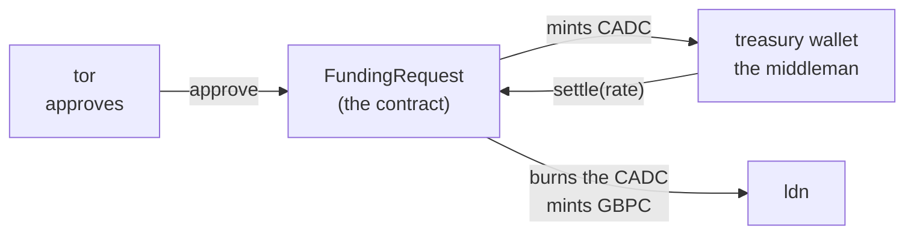
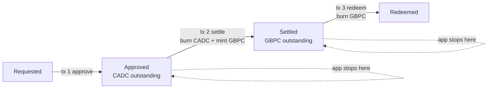

# The middleman wallet, and keeping each step one unit of work

> Companion docs: [README.md](README.md) · [wallets-explained.md](wallets-explained.md) · [chaincode-explained.md](chaincode-explained.md) · [tokens-explained.md](tokens-explained.md) · [use-case.md](use-case.md)
> Questions answered here: *what is the `treasury` wallet really for, how far can it be trusted, and how do we make sure that burning one currency and minting the other happen together or not at all?*

**Short answer.**
1. The `treasury` wallet is the **exchange desk** between CAD and GBP. It holds the CADC between approval and settlement, supplies the exchange rate, and is the only wallet that may trigger the conversion. It holds no money of its own and cannot create or destroy tokens: only the `FundingRequest` contract can.
2. The burn of CADC and the mint of GBPC are **one unit of work** because they happen inside **one transaction**, in one contract function (`settle`). The chain either keeps all of that transaction or none of it. This is a property of the EVM, not of our app, and three contract tests prove it with a token that is made to fail half way.
3. The steps *between* transactions (approve, settle, redeem) are **not** one unit of work. Each is safe on its own and the flow can resume after a stop, which is a different technique (section 4).

**Contents:** [1. The middleman](#1-the-middleman) · [2. How far to trust it](#2-how-far-to-trust-it) · [3. One unit of work: what is atomic](#3-one-unit-of-work-what-is-atomic) · [4. What is not atomic, and how it stays safe](#4-what-is-not-atomic-and-how-it-stays-safe) · [5. Failure matrix](#5-failure-matrix) · [6. The proof](#6-the-proof) · [7. What would break it](#7-what-would-break-it) · [8. Other designs, and a checklist](#8-other-designs-and-a-checklist)

---

## 1. The middleman



| Question | Answer |
|---|---|
| What does it hold? | CADC, and only from `approve` until `settle`. After `settle` its balance for that request is 0 again |
| What does it decide? | **When** to convert (it signs `settle`) and **at what rate** (it passes `ratePpm`). Nothing else |
| What can it not do? | Approve or reject, create requests, redeem, mint, burn by itself, settle a request that is not `Approved`, settle twice, use a rate outside the contract's bounds |
| Is there a person behind it? | No. The treasury service in the web app signs for it through FireFly, reading the rate from `fx-rates.json`. In real life this would be a treasury system with its own controls |
| Does it earn a spread? | No. CAD in, GBP out, at the recorded rate. The `Settled` event shows both amounts and the rate |

**Why it exists as a separate wallet.** Three jobs have to be kept apart, so that no one wallet can move money alone:

| Job | Wallet | Why not combine |
|---|---|---|
| Ask | `ldn` | If the asker could also convert, it could pick its own rate |
| Permit | `tor` | If the approver could also convert, one person could approve and choose the rate |
| Convert | `treasury` | The only one allowed to turn an approved CAD claim into GBP |

Without a place to hold the CADC, the approved CAD would have to sit with `ldn`, who would then own both currencies for the same request. The treasury wallet is that place.

## 2. How far to trust it

The contract limits what the middleman can do, but not everything. Be clear about both.

| If the `treasury` key is... | What can happen | What cannot happen |
|---|---|---|
| **Stolen** | The thief can settle any `Approved` request at any rate between `minRatePpm` and `maxRatePpm` (0.40 to 0.80), so a wrong rate can cause an over- or under-payment up to those bounds | Mint tokens freely, send the CADC it holds to another wallet (the tokens cannot be moved), touch a request that is not `Approved`, settle twice, change who may approve |
| **Absent** (stopped, lost) | Approved requests wait. Nothing is lost; CADC stays outstanding | Anyone else settling in its place |
| **Wrong** (a bad rate in `fx-rates.json`) | A wrong GBP amount, if the typo is inside the bounds. The rate is recorded in the `Settled` event, so it is visible and auditable | A rate outside 0.40 to 0.80 (the contract refuses) |
| **Colluding with `tor`** | Approve and settle a request of their own making | Anything beyond the CAD cap per request, or minting outside the flow |

**The honest weak point is the rate.** The contract does not know the market: it accepts any rate the treasury passes within a bound. The bound is 0.40 to 0.80, around a real CAD to GBP rate of about 0.55 to 0.60, so it catches typos like `580`, `0.058` or `0.90` for `0.58`, but not `0.62` for `0.58`. Inside the bound a wrong rate is still paid, and it is visible in the `Settled` event. Ways to tighten it further:

| Option | Effect |
|---|---|
| ~~Narrow `minRatePpm` and `maxRatePpm` at deploy~~ **done: 0.40 to 0.80** (it was 0.01 to 5.00). Narrower still, for example 0.55 to 0.60, works until the market moves out of it | Cheap. Needs a redeploy to change |
| A rate oracle contract that `settle` reads, so the treasury passes no number | The rate is on-chain and not chosen by the treasury. Bigger scope |
| Two-person control: a second approver for the rate | A second signature before `settle` |
| A daily rate committed on-chain by one wallet, `settle` checks against it | Separates "setting the rate" from "settling" |
| ~~Make `CADC` and `GBPC` non-transferable~~ **done** | It closed a hole found while writing this page: a holder could `transfer` its tokens away, so `settle` or `redeem` would fail with `InsufficientBalance` and the request would be stuck. The functions no longer exist, and tests prove it |

## 3. One unit of work: what is atomic

A **unit of work** is a group of changes that must all happen or none. On this chain, **one transaction is one unit of work**: if any line of it fails, the chain throws away every change that transaction made so far.

The code of `settle` ([FundingRequest.sol](../../contracts/treasury/contracts/FundingRequest.sol) lines 109 to 122):

```solidity
require(r.status == Status.Approved, "BadState");        // checks first
require(msg.sender == treasury, "NotTreasury");
require(ratePpm >= minRatePpm && ratePpm <= maxRatePpm, "BadRate");
uint256 gbp = (r.amountCad * ratePpm) / RATE_SCALE;
require(gbp > 0, "BadAmount");
r.status = Status.Settled;                               // then the state
r.amountGbp = gbp;
r.ratePpm = ratePpm;
emit Settled(id, r.amountCad, gbp, ratePpm);             // the audit note
cadc.burn(treasury, r.amountCad);                        // burn CAD
gbpc.mint(r.requester, gbp);                             // mint GBP
```

Everything from the first line to the last is **one** transaction signed by `treasury`. How the guarantee works:

| Mechanism | What it gives | Where |
|---|---|---|
| **Revert undoes the whole transaction** | If a `require` fails, or a call inside fails, the EVM restores every storage change of the transaction: the state, the burn, the mint, the event | The EVM itself |
| **A failure in a nested call bubbles up** | `cadc.burn` and `gbpc.mint` are calls to other contracts. If one reverts, Solidity re-raises the revert, so the outer `settle` also fails and its earlier changes (including the burn) go with it | Solidity's default for calls to a contract. **Never wrapped in `try`/`catch`** |
| **One caller for both tokens** | `FundingRequest` is the only controller of `CADC` and `GBPC`, so nobody can run a burn or a mint between the two lines | `setController` once per token |
| **One block, final** | A transaction is in one block. With QBFT the block is final, so no node ever shows "burnt but not minted" | Besu consensus |
| **State is changed before the token calls** | A request cannot be re-entered in a half-done state | Lines 116 to 118 before 120 and 121 |

The same holds for the other two money steps:

| Step | One unit of work contains | If part of it fails |
|---|---|---|
| `approve` | state `Approved` + approver recorded + event + **mint CADC** | The mint fails: state is back to `Requested`, no approver |
| `settle` | state `Settled` + GBP amount + rate + event + **burn CADC** + **mint GBPC** | The mint fails: the burn is undone, state back to `Approved`, no amount, no rate |
| `redeem` | state `Redeemed` + event + **burn GBPC** | The burn fails (balance too low): state back to `Settled` |

So at no moment does the chain show CADC and GBPC both outstanding for one request, or a request `Settled` with no GBPC.

## 4. What is not atomic, and how it stays safe

`approve`, `settle` and `redeem` are three transactions, signed by three wallets, at different times. Between them the request sits in a **stable state** (`Approved`, `Settled`). That is a *saga*: a chain of small units of work, each safe, with a way to continue after an interruption.



| Danger between steps | How it is handled |
|---|---|
| The app stops after `approve` | The state `Approved` is on the chain. At the next start the service reads every request and settles those still `Approved` |
| The app stops after `settle` | Same: it finds `Settled` and redeems |
| The same click or retry is sent twice | Each write has the key `<request UUID>:<action>`. FireFly refuses a second write with the same key, and the app reports it as `pending`, never as done twice. Even without the key, the contract refuses a repeat with `BadState` |
| A try was **refused** (wrong wallet, rate outside the bounds) and the cause is now fixed | FireFly keeps the key of a refused try, so the same key can never succeed, and the first version of the app got stuck here. The gateway now asks FireFly about the earlier transaction: if it never went out (its operation is `Failed`, or `Initialized`, which is what a contract refusal at gas estimation leaves), the write is sent again under a new key (`<key>-after-<first 8 characters of the old transaction id>`, the same every time, up to 5 times). If the earlier try succeeded or is still `Pending`, it is **not** sent again |
| FireFly does not answer in time | The result is unknown, so the app shows **pending** and never "done". It reads the chain to see what really happened |
| The FX rate is missing | The request waits as `Approved` with the reason shown; adding the rate and pressing **Retry settle** continues it |
| A step fails | The request stays in its last good state. Retrying is safe because a failed step changed nothing (section 3) |

The rule that makes this work: **the service decides from the state it reads back from the chain, never from what it remembers.** A restart, a second copy of the app, or a lost log cannot make it do the wrong thing.

## 5. Failure matrix

| Where it fails | State after | CADC | GBPC | Recovery |
|---|---|---|---|---|
| `createRequest` reverts (bad amount, date, wallet) | none | 0 | 0 | Fix the input and send again |
| `approve` reverts (wrong wallet, own request, already decided) | `Requested` | 0 | 0 | Use the right wallet |
| `approve`: the CADC mint fails | `Requested` (state undone) | 0 | 0 | Retry |
| `approve` succeeds, app stops | `Approved` | outstanding | 0 | The next start settles it |
| `settle`: no rate, bad rate, wrong wallet | `Approved` | outstanding | 0 | Add the rate and press **Retry settle** |
| `settle`: the GBPC mint fails (after the CADC burn) | `Approved` (burn undone) | outstanding | 0 | Retry |
| `settle` succeeds, app stops | `Settled` | 0 | outstanding | The next start redeems it |
| `redeem`: the burn fails (cannot happen in normal use: the GBPC cannot be moved, so it is still there) | `Settled` | 0 | outstanding | Retry |
| `redeem` succeeds | `Redeemed` | 0 | 0 | none needed |

In no row do both currencies exist for one request, and in no row is a token created or destroyed without its state change.

## 6. The proof

| Evidence | Where | What it shows |
|---|---|---|
| `test_SettleUndoesTheBurnWhenTheMintFails` | [contracts/treasury/test/Atomicity.t.sol](../../contracts/treasury/test/Atomicity.t.sol) | GBPC is replaced by a token whose mint always fails. `settle` reverts and afterwards the request is still `Approved`, the CADC supply is untouched, the treasury still holds it, and no rate or GBP amount was recorded. The burn really did run first, and it was undone |
| `test_ApproveUndoesTheStateWhenTheMintFails` | same | CADC mint fails: `approve` reverts, state is still `Requested`, no approver recorded |
| `test_ARetryAfterAFailedSettleWorks` | same | A bad first attempt changes nothing; the retry then settles exactly once |
| `test_TheBeneficiaryCannotSendTheGbpAwayBeforeRedeeming`, `test_TheTreasuryCannotSendTheCadAwayBeforeSettling`, `test_AHolderCannotMoveTokens` | [FundingRequest.t.sol](../../contracts/treasury/test/FundingRequest.t.sol), [CurrencyToken.t.sol](../../contracts/treasury/test/CurrencyToken.t.sol) | Tokens cannot be moved, so the CADC and GBPC the burns need are always there |
| Fuzz test, 256 random amounts and rates | same file | After each step the supplies follow the four stages exactly |
| **Mutation check** (done 2026-10-20) | by hand | The contract was changed to hide a failing mint with `try { gbpc.mint(...) } catch {}`, then the same for the CADC mint. In both cases the atomicity test failed. So the tests would notice if someone broke the guarantee |
| Live invariant | `assert_conserved()` in [test_treasury_flow.py](../../tests/integration/test_treasury_flow.py), also the green "Books balance" line on the Ledger tab | On a real chain, after every step, CADC outstanding = CAD of `Approved` requests and GBPC outstanding = GBP of `Settled` requests |

Run them: `cd contracts/treasury && npm test` (35 tests).

## 7. What would break it

These design changes would silently remove the guarantee. Treat them as review red flags.

| Change | Why it breaks atomicity |
|---|---|
| Doing the burn and the mint in **two transactions** (for example two calls from the app) | A stop between them leaves CADC burnt and no GBPC, or both outstanding. This is why the app never calls `burn` or `mint` itself |
| Wrapping a token call in **`try`/`catch`** and carrying on | The failed half would be forgotten while the other half stays |
| Using a token that **returns `false` instead of reverting** on failure, without checking the result | The call "succeeds" and the transaction keeps going. `CurrencyToken` always reverts, and both tokens are our own code |
| Making the tokens **upgradeable or callable by another contract** | A third contract could change a balance between the burn and the mint, or call back into `settle` |
| Moving CAD and GBP onto **two different chains** | One transaction cannot span two chains. You would need a two-phase protocol such as a hash time-locked contract, with its own failure cases |
| Adding **more controllers** to the tokens | Another caller could mint outside the flow and break the conservation rule |
| Mixing **off-chain steps** (a bank payment, a database write) into the same step | The chain cannot undo an off-chain action. Put the off-chain action *after* a state like `Settled` and make it idempotent |

The last point matters in real life: **`redeem` only burns the GBPC. The actual payout of pounds is off-chain** and is not part of the unit of work. A real system would pay out when it sees `Redeemed`, keyed by the request id so a repeat pays nothing.

## 8. Other designs, and a checklist

| Design | Atomic units | Compared with v1 |
|---|---|---|
| **v1 (built):** the treasury only holds approved CADC, tokens are minted and burnt | `approve`, `settle`, `redeem` | Simple; the supply of each token always matches open requests; CADC and GBPC never pile up |
| **Treasury with inventory:** it holds a stock of GBPC and *transfers* instead of minting | `settle` = transfer CADC in, transfer GBPC out, both inside the contract | Needs liquidity management and can run out. Still atomic per swap |
| **Rate from an oracle contract** | Same units, one fewer thing the treasury controls | Removes the weak point in section 2; adds an oracle to trust |
| **No middleman:** the contract converts straight at approval | One unit: approve = burn nothing, mint GBPC directly | The approver would pick the rate, or the contract would need the oracle. Loses the separation of duties |

**Checklist for any change to `settle`, `approve` or `redeem`:**
1. Do all token calls stay inside the same function, with no `try`/`catch`?
2. Is the state changed before the first token call?
3. Does each token call revert on failure (no silent `false`)?
4. Is the contract still the only controller of both tokens?
5. Is there a test that makes the *second* half fail and checks that the *first* half was undone?
6. Does the mutation check (swallow the failure) still make that test fail?
