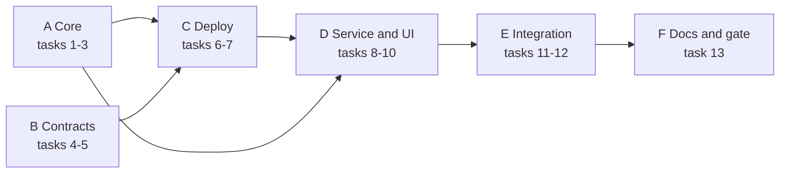

# Tasks: Treasury branch funding

> Source: [prd.md](prd.md) TR-US-01 to 06, TR-FR-01 to 12; [design.md](design.md) TD-01 to TD-12; [use-case.md](use-case.md) UC-T1 to T5. Format follows `tasks/phase-4-cli.md`.
> **Status (2026-10-19): in progress. "start implement" was taken as acceptance of the recommended answer to every Open Question in prd.md §9.**
> **Done and checked on the live stack (2026-10-19): tasks 1 to 12.** `ruff`, `mypy`, 879 unit tests; 31 contract tests; after `reset`, `up`, `deploy`: `pytest -m integration` 133 passed (17 are the new treasury tests, and the older ones still pass); `pytest -m fresh_stack` passed. `stack.py treasury` run twice sent no second transaction. The exit gate's three from-reset runs were made (`reset`, `up`, then the whole `pytest -m integration`, each time 133 passed, in 19 to 24 minutes). **Not done:** task 13 was done on 2026-10-20 (`plan.md` D-18 to D-24, `deliverables.md` DL-7.x, `PROJECT.md`, the README, a pointer in `use-cases.md`).
> Where the code differs from the first draft of this list: the gateway, the service and the views are in `src/core/treasury/` (they do no I/O; everything is passed in); `tzdata` was added as a dependency (Windows has no time-zone data); `stack.py treasury` reuses the T-REX `run_plan`.
> Verification commands (PROJECT.md): `ruff check .`, `mypy .`, `pytest`, `pytest -m integration`. Work on `main`, one commit per task (memory: no feature branches). Tests first: write the failing test, see it fail, then implement.

## Overview

Six groups, built bottom-up so each one can be checked before the next depends on it.

Sizes: S under 1 hour, M a few hours. No task is larger than M.

---

## Group A: pure core (no I/O)

### Task 1: Money and FX in `src/core/treasury/`
**Description:** `money.py`: `parse_amount("1000.00") -> 100000`, `format_amount`, cap check. `fx.py`: parse the rate table to `ratePpm`, `lookup(table, pair, date) -> (ratePpm, source)` with order date then `default` then `FxRateMissing`, `convert_cad_to_gbp(cad_minor, rate_ppm)` using integer floor division.
**Acceptance:**
- [ ] `100000 × 580000` gives `58000`; `10001 × 580000` gives `5800` (floor); a result of 0 is an error
- [ ] "1,000", "1000.001", "-5", "0", "abc", "1e3" and above-cap amounts are rejected with a specific error each
- [ ] A rate with 7 decimals, a negative rate or a non-numeric rate is rejected; no `float` appears in the package (a test scans the source)
**Verification:** `pytest tests/unit/core/test_treasury_money.py tests/unit/core/test_treasury_fx.py`, `ruff check .`, `mypy .` · **Size:** M

### Task 2: Request model, state machine, ids and dates
**Description:** `request.py`: `Status`, `allowed(from, action)`, `validate_create(...)`. `ids.py`: UUID to `bytes32`, `idempotency_key(id, action)`. `dates.py`: `processing_date(now_utc, zone) -> 20261018` with the clock passed in. `ledger.py`: `check_conservation(requests, cadc_supply, gbpc_supply)`.
**Acceptance:**
- [ ] Every transition not in the state machine is refused (table test over all 6 states × 5 actions; 5 are legal)
- [ ] `processing_date` at 2026-10-18T22:30Z gives `20261018` for `Europe/London` (BST, UTC+1, so 23:30 local) and `20261019` for `Asia/Tokyo`; a DST-boundary case is included
- [ ] The conservation check accepts the four valid stages of one request and rejects a supply that is off by 1
**Verification:** `pytest tests/unit/core -k treasury` · **Size:** M

### Task 3: Treasury errors and outcome mapping
**Description:** `errors.py` (validation, `FxRateMissing`, wrong state) and a function that maps a FireFly outcome (`Succeeded`, `Failed`, `ComplianceRevert`, `Pending`) plus the request state into what the UI shows. Reuse `src/core/firefly/outcome.py`; do not copy it.
**Acceptance:**
- [ ] Only `Succeeded` maps to a success message; `Pending` carries the operation id
- [ ] Contract revert names (`NotApprover`, `SelfApproval`, `BadState`, `NotTreasury`, `BadRate`, `NotBeneficiary`, `BadAmount`, `BadDate`, `Exists`, `ReasonTooLong`) map to a readable message each
- [ ] Core has no `print`, `input` or network call (same scan test as Phase 4)
**Verification:** `pytest tests/unit/core -k treasury` · **Size:** S

**Checkpoint A:** unit tests, `ruff`, `mypy` green. Core can be used without Docker.

---

## Group B: contracts

### Task 4: Compile toolchain spike (gate for B and C)
**Description:** With the approved `solc` (Q5) pinned in `contracts/package.json`, compile a trivial contract with `evmVersion: shanghai`, deploy it through FireFly's contract deploy API on the live stack, call it through a contract API. Record what happened in `docs/treasury-use-case/spike.md` (short).
**Acceptance:**
- [ ] The deploy succeeds and a read returns the expected value
- [ ] The compile command and the solc version are written down
- [ ] If it fails, the fallback (a different compiler packaging, or hand-assembled artifacts) is chosen and written before Task 5
**Verification:** run on the live stack (`up`, `deploy`); `pytest -m integration` unchanged · **Size:** M

### Task 5: `CurrencyToken` and `FundingRequest` with contract tests
**Description:** Write both contracts as in design §3. Tests first, in the contract test setup chosen in Task 4 (Hardhat 3 Solidity tests via the `hardhat` skill, or the solc output run against the live chain from pytest if Hardhat is not approved). Commit sources, ABI+bytecode artifacts and `contracts/treasury/SHA256SUMS`.
**Acceptance:**
- [ ] Every row of the design §3.2 rule table has a passing test for the success case and one for each revert
- [ ] Fuzz or table test: for random amounts and rates, `gbp = floor(cad × rate / 1e6)` and supplies obey TR-NFR-02 at every stage
- [ ] Only `FundingRequest` can mint or burn; the admin cannot; the controller cannot be set twice
- [ ] Contract size is far under 24 KB; checked with the `solidity-security` checklist and the findings noted
**Verification:** the contract test command; `sha256sum -c contracts/treasury/SHA256SUMS` · **Size:** M

---

## Group C: deploy

### Task 6: Wallets and `stack.py treasury` deploy
**Description:** Add `ldn`, `tor`, `treasury` to `wallets.json` and the signer keystore using the existing generator code (see `docs/wallets.md` §5), only if missing. `src/adapters/treasury_deploy.py` deploys `CADC`, `GBPC`, `FundingRequest` through FireFly (constructor: roles, bounds, token addresses), sets the token controller, registers interfaces and APIs, and writes the addresses (`cadc`, `gbpc`, `funding-request`) to `deployed-addresses.json`. Add `treasury` to `stack_cli.py`.
**Acceptance:**
- [ ] After `up`, `deploy`, `treasury` the three addresses are non-zero and `FundingRequest.treasury()` equals the `treasury` wallet
- [ ] A second `treasury` run sends no transaction (idempotent), proven by an unchanged block-count of transactions from `admin`
- [ ] `reset` removes the new addresses and the `docker compose up` path is unaffected
**Verification:** `pytest tests/unit/adapters/test_treasury_deploy.py`; integration `test_treasury_deploy_is_idempotent` · **Size:** M

### Task 7: Treasury FireFly gateway wrapper
**Description:** A small adapter class over the existing `FireflyClient` with typed methods `create`, `approve`, `reject`, `settle`, `redeem`, `get_request`, `list_requests`, `balances`. It builds idempotency keys with core `ids.py`. No new HTTP code.
**Acceptance:**
- [ ] Unit tests with the mocked `FireflyPort` assert the exact API name, method, signer and `idempotencyKey` for each call
- [ ] A duplicate key (409 `FF10431`) returns the first operation instead of raising
**Verification:** `pytest tests/unit/adapters/test_treasury_gateway.py` · **Size:** S

**Checkpoint C:** `up`, `deploy`, `treasury` on a fresh stack work; existing 54 integration tests still pass.

---

## Group D: service and UI

### Task 8: Treasury service (steps 5 to 7)
**Description:** `treasury_service.py`: `sweep()` per design §5, reads the FX file through `treasury_fx_file.py`, settles `Approved`, redeems `Settled`, records "blocked" reasons in memory. Called after each approve and at app start.
**Acceptance:**
- [ ] Unit tests with a fake gateway: missing rate keeps `Approved`; found rate calls `settle` once with the right `ratePpm`; `Settled` triggers `redeem`; a second `sweep()` sends nothing
- [ ] A `Pending` settle is not repeated and not reported as success
- [ ] Logs carry `requestId`, `action`, `operationId`, `outcome`
**Verification:** `pytest tests/unit/adapters/test_treasury_service.py` · **Size:** M

### Task 9: HTTP API
**Description:** `treasury_http.py` implements the endpoints in design §7 with sync handlers, JSON errors, and a per-tab wallet allow-list. Binds to `127.0.0.1`.
**Acceptance:**
- [ ] Each endpoint has a unit test with the gateway faked: 202 on success, 400 for bad amount, 409 for wrong state or duplicate, 502 if FireFly is unreachable
- [ ] The server refuses to start on a non-loopback address unless a flag is given
- [ ] No private key or keystore password appears in any response or log (test)
**Verification:** `pytest tests/unit/adapters/test_treasury_http.py` · **Size:** M

### Task 10: The page
**Description:** `index.html` with three views: LDN (form, my requests), TOR (pending list, approve, reject with reason), Ledger (all requests, balances, supplies, FX table). Plain JS, no `innerHTML` with server text, a visible "demo" banner.
**Acceptance:**
- [ ] A scripted browser run (`playwright-e2e` skill) walks UC-T1 and UC-T2 against the live app
- [ ] A request whose reason is `` shows as text and runs no script
- [ ] Every action button shows a spinner and is disabled while pending
**Verification:** the browser run; manual look at the three views · **Size:** M

**Checkpoint D:** `python scripts/treasury_app.py` serves the page and UC-T1 works by hand.

---

## Group E: integration tests

### Task 11: Funding flow tests
**Description:** `tests/integration/test_treasury_flow.py` as in [test-plan.md](test-plan.md) §3, using the HTTP API and `tests/support/firefly.py` for independent reads.
**Acceptance:**
- [ ] The happy path, reject, self-approval, non-approver, double approve, wrong-state settle, missing rate, idempotent retry, and restart-recovery tests all pass
- [ ] The conservation invariant is asserted after every step
- [ ] Three consecutive runs from `reset` pass (as D-17 did)
**Verification:** `pytest -m integration tests/integration/test_treasury_flow.py` ×3 · **Size:** M

### Task 12: Regression and `fresh_stack`
**Description:** Run the whole suite and the `fresh_stack` test, fix anything the new wallets or addresses file broke.
**Acceptance:**
- [ ] `pytest -m integration` passes in full (54 existing + new)
- [ ] `pytest -m fresh_stack` still passes
**Verification:** both commands · **Size:** S

---

## Group F: docs and gate

### Task 13: Fold into the project docs
**Description:** Move accepted TD-xx rows to `docs/plan.md` §3 as D-18 and up; add TR rows to `docs/deliverables.md`; add UC-T1 to `docs/use-cases.md` as a link; add a README section "Try the treasury flow"; update `PROJECT.md` (commands and directory layout).
**Acceptance:**
- [ ] Every doc edit points back to this folder instead of copying text
- [ ] Mermaid diagrams render (checked with a Mermaid parser)
**Verification:** read-through; `ruff check .` and `mypy .` clean · **Size:** S

**Exit gate:** `ruff`, `mypy`, `pytest` green; `pytest -m integration` green three times from `reset`; UC-T1 and UC-T2 shown in the browser; Howin has reviewed.

---

## Dependencies and decision points

| Needs | Before |
|---|---|
| Q5 (compiler) | Task 4 |
| Q1, Q2 | Tasks 5, 8 (they change contract and service behaviour) |
| Q6 (UI stack) | Task 9 |
| Task 4 result | Tasks 5, 6 |
