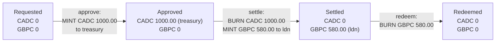

# The tokens: CADC and GBPC, line by line

> Companion docs: [README.md](README.md) · [chaincode-explained.md](chaincode-explained.md) · [wallets-explained.md](wallets-explained.md) · [middleman-and-atomicity.md](middleman-and-atomicity.md) · [use-case.md](use-case.md)
> **Where the program is:** [README.md, "Where everything is"](README.md#where-everything-is) lists every file and shows what runs where.
> Source: [contracts/treasury/contracts/CurrencyToken.sol](../../contracts/treasury/contracts/CurrencyToken.sol) (61 lines). Every line is explained below. You need no blockchain background.

**Short answer.** A token here is **a table inside a contract**: it lists addresses and how much each one holds. There is no coin object anywhere else. `CADC` stands for Canadian dollars on the chain, `GBPC` for pounds. They are the **same code deployed twice** (source: `contracts/treasury/contracts/CurrencyToken.sol`; on the chain at the addresses `cadc` and `gbpc` in `deployed-addresses.json`), with different names. Only one other contract, `FundingRequest`, may create (**mint**) or destroy (**burn**) them, and it does so only at three moments in the funding flow. **Nobody can move them**: there is no `transfer`, so a holder cannot send tokens away.

**Contents:** [1. The ideas](#1-the-ideas) · [2. The two tokens](#2-the-two-tokens) · [3. How a balance moves through the flow](#3-how-a-balance-moves-through-the-flow) · [4. The code, line by line](#4-the-code-line-by-line) · [5. What the tokens do not do, and why](#5-what-the-tokens-do-not-do-and-why) · [6. Try it](#6-try-it) · [7. Check yourself](#7-check-yourself)

---

## 1. The ideas

| Word | Plain meaning |
|---|---|
| **Token** | A table in a contract: `address → number`. "Anson holds 5 CADC" means the table has `anson's address → 500` |
| **ERC-20** | A common agreement on the names of the functions and events a token has (`balanceOf`, `totalSupply`, `Transfer`, ...) so wallets and tools understand any token. These tokens keep ERC-20's *read* side and its `Transfer` event, but leave out the functions that move tokens between holders (see section 5) |
| **Mint** | Add to somebody's entry, and to the total. Money is created |
| **Burn** | Take from somebody's entry, and from the total. Money is destroyed |
| **Total supply** | How much exists. Mint raises it, burn lowers it. Nothing else changes it |
| **Decimals** | How many digits sit after the point. The chain only stores whole numbers, so `2` decimals means the stored number `100000` is shown as `1000.00` |
| **Controller** | The one address allowed to mint and burn. Here it is the `FundingRequest` contract, never a person |

Why whole numbers: computers add whole numbers exactly, but `0.1 + 0.2` in floating point is `0.30000000000000004`. Money code must never do that, so everything in this project is an integer count of cents or pence, from the web page to the contract.

## 2. The two tokens

| | `CADC` | `GBPC` |
|---|---|---|
| Name and symbol | `Canadian Dollar Coin`, `CADC` | `Pound Sterling Coin`, `GBPC` |
| Stands for | 1.00 CAD per 1.00 token | 1.00 GBP per 1.00 token |
| Decimals | 2 (stored `100000` = `1000.00`) | 2 (stored `58000` = `580.00`) |
| Code | `CurrencyToken.sol` | the same file, deployed a second time |
| Who may mint and burn | only `FundingRequest` | only `FundingRequest` |
| Can a holder move it? | No | No |
| Exists when | a request is `Approved` | a request is `Settled` |
| Address | `deployed-addresses.json`, key `cadc` | `deployed-addresses.json`, key `gbpc` |

`COIN` (the T-REX token used in the rest of the project) is unrelated. It is a normal transferable token with identity checks and 18 decimals; these two have neither.

## 3. How a balance moves through the flow

The same numbers as [use-case.md](use-case.md), seen from the tokens:



At every moment, CADC outstanding equals the CAD of the `Approved` requests and GBPC outstanding equals the GBP of the `Settled` ones. The tests check this after every step. Because tokens cannot be moved, the CADC is always in the treasury wallet and the GBPC always in the requester's wallet, exactly where the flow put them.

---

## 4. The code, line by line

Line numbers match the file. Read each block, then its table.

### Lines 1 to 10: the header

```solidity
 1  // SPDX-License-Identifier: UNLICENSED
 2  pragma solidity 0.8.28;
 3
 4  /// A ledger token for one currency (2 decimals). It has the ERC-20 read functions and events, but
 5  /// it is NOT transferable: there is no transfer, approve or transferFrom. Tokens are only created
 6  /// (mint) and destroyed (burn), and only by the `controller`, which is the FundingRequest contract
 7  /// and is set once by the admin (TD-02). So a holder can neither send tokens away nor block a
 8  /// step by moving them.
 9  /// Reverts use plain strings: FireFly's error text carries only Error("...") reasons.
10  contract CurrencyToken {
```

| Line | What it does |
|---|---|
| 1 | A comment that names the licence. `UNLICENSED` means "not open source", which is right for a demo. The compiler warns if it is missing |
| 2 | Says which compiler version may build this file. Not `^0.8.28` ("this or newer") but exactly `0.8.28`, so the bytecode on the chain is always the one we tested |
| 3 | Blank |
| 4 to 9 | `///` comments describe the contract. They change nothing at run time. Lines 5 to 8 state the key design choice: **no transfers**. Line 9 explains another choice you will see below: errors are plain words such as `"NotController"`, because FireFly's error reports only show errors written as `Error("...")`. A newer Solidity style (custom errors) would show up as "no reason given" |
| 10 | Opens the contract. A contract is like a class: it has stored values (state) and functions. It lives at one address once deployed. The `}` on line 61 closes it |

### Lines 11 to 19: what the contract remembers

```solidity
11      string public name;
12      string public symbol;
13      uint8 public constant decimals = 2;
14
15      uint256 public totalSupply;
16      mapping(address => uint256) private balances;
17
18      address public immutable admin;
19      address public controller;
```

| Line | What it does |
|---|---|
| 11 | A text value `name`, for example `Canadian Dollar Coin`. `public` makes Solidity create a free read function called `name()` |
| 12 | The short symbol, for example `CADC`. Also readable as `symbol()` |
| 13 | `decimals` is a whole number (`uint8`: 0 to 255). `constant` means it is written into the code and can never change, so it costs nothing to read. Always `2` |
| 15 | `totalSupply`: how many token units exist. `uint256` is an unsigned whole number of 256 bits (about 10^77), far bigger than any amount here. "Unsigned" means it can never be negative |
| 16 | The **ledger itself**. A `mapping` is a table from key to value: from an `address` (a wallet) to how many units it holds. Missing keys read as 0. `private` means no outside caller can read the table directly; the getter on lines 34 to 36 is the way in (see there for why) |
| 18 | `admin`: the address that deployed the token. `immutable` means it is set once, when the contract is created, and can never change, like a constant that is decided at deploy time |
| 19 | `controller`: the one address allowed to mint and burn. It starts empty (the zero address) and is set exactly once by `setController` (line 38) |

There is **no table of allowances** any more: that existed only to let one wallet spend another's tokens, which is no longer possible.

### Lines 21 to 24: events

```solidity
21      // The standard ERC-20 event. A mint is a Transfer from the zero address, a burn is a Transfer
22      // to the zero address, so wallets and the Explorer show them correctly.
23      event Transfer(address indexed from, address indexed to, uint256 value);
24      event ControllerSet(address indexed controller);
```

An **event** is a note the contract writes into the transaction's log. Nothing in the contract reads it; outside tools (FireFly, the Explorer, auditors) do. `indexed` makes a field searchable ("show me every Transfer to this address").

| Line | What it does |
|---|---|
| 21, 22 | A comment. By ERC-20 convention a **mint** is a `Transfer` *from* the zero address and a **burn** is a `Transfer` *to* the zero address, so wallets show them correctly |
| 23 | The `Transfer` event. It is still announced on every mint (line 51) and burn (line 59), even though holders can no longer transfer, so the history is readable by any ERC-20-aware tool |
| 24 | Announced once, when the controller is set (line 43) |

### Lines 26 to 31: the constructor

```solidity
26      constructor(string memory name_, string memory symbol_, address admin_) {
27          require(admin_ != address(0), "BadAdmin");
28          name = name_;
29          symbol = symbol_;
30          admin = admin_;
31      }
```

The constructor runs **once**, at deployment, and never again. This is where `CADC` and `GBPC` become different: the deploy plan passes `("Canadian Dollar Coin", "CADC", admin)` the first time and `("Pound Sterling Coin", "GBPC", admin)` the second.

| Line | What it does |
|---|---|
| 26 | The three values the deployer must supply. `memory` means a temporary copy of the text. The trailing `_` in the names only avoids clashing with the stored `name`, `symbol`, `admin` |
| 27 | `require(condition, "Message")` is the safety check used everywhere in this project: if the condition is false, the whole transaction is undone and the message is the reason. Here: the admin must not be the zero address (`address(0)` means "nobody"), because then nobody could ever set the controller |
| 28 to 30 | Store the three values |

### Lines 33 to 36: reading a balance

```solidity
33      // Explicit getter, not a public mapping: FireFly passes inputs by name and a mapping getter has none.
34      function balanceOf(address account) external view returns (uint256) {
35          return balances[account];
36      }
```

| Line | What it does |
|---|---|
| 33 | Explains the choice. If line 16 said `public`, Solidity would build a `balanceOf` for us, but its input would have **no name**. FireFly passes inputs by name (`{"account": "0x..."}`), so we write the function ourselves to give the input a name |
| 34 | A function anyone can call. `external`: callable from outside only. `view`: it only reads and never changes anything, so calling it is free and needs no transaction. Takes an `account`, returns a number |
| 35 | Looks the address up in the table. An address that never held anything gives 0 |
| 36 | Closes the function |

### Lines 38 to 44: setting the controller (once)

```solidity
38      function setController(address controller_) external {
39          require(msg.sender == admin, "NotAdmin");
40          require(controller == address(0), "ControllerSet");
41          require(controller_ != address(0), "BadController");
42          controller = controller_;
43          emit ControllerSet(controller_);
44      }
```

`msg.sender` is the address that called the function. The chain checks the signature, so it cannot be faked.

| Line | What it does |
|---|---|
| 38 | Anyone may *try* to call it; the checks decide |
| 39 | Only the admin. Anyone else gets `NotAdmin` and nothing changes |
| 40 | Only if no controller is set yet. This is the "set once" lock: a second call gets `ControllerSet`. After this, not even the admin can swap the controller |
| 41 | The new controller cannot be the zero address, which would lock minting forever |
| 42 | Stores it |
| 43 | Writes the `ControllerSet` event |

`python scripts/stack.py treasury` calls this twice, once per token, passing the `FundingRequest` address. After that, the admin has no power over the money.

### Lines 46 to 52: mint

```solidity
46      function mint(address to, uint256 amount) external {
47          require(msg.sender == controller, "NotController");
48          require(to != address(0), "BadRecipient");
49          totalSupply += amount;
50          balances[to] += amount;
51          emit Transfer(address(0), to, amount);
52      }
```

| Line | What it does |
|---|---|
| 46 | Create `amount` units for `to` |
| 47 | **The key rule.** Only the controller (`FundingRequest`) may mint. A wallet, the admin, anyone else: `NotController` |
| 48 | Not to the zero address (those units would be lost) |
| 49 | The total goes up |
| 50 | The holder's entry goes up. Since Solidity 0.8 an addition that would overflow stops the transaction instead of wrapping around, so there is no hidden overflow bug |
| 51 | Logs a `Transfer` from the zero address, the convention for "minted" |

### Lines 54 to 60: burn

```solidity
54      function burn(address from, uint256 amount) external {
55          require(msg.sender == controller, "NotController");
56          require(balances[from] >= amount, "InsufficientBalance");
57          balances[from] -= amount;
58          totalSupply -= amount;
59          emit Transfer(from, address(0), amount);
60      }
61  }
```

| Line | What it does |
|---|---|
| 54 | Destroy `amount` units held by `from` |
| 55 | Again only the controller. Note what this means: `FundingRequest` can burn from the treasury or from a beneficiary **without their signature or an allowance**. That is the design (the contract is the only caller, and it only does so inside `settle` and `redeem`), and it is why that contract must be small and tested |
| 56 | You cannot burn what is not there. Because holders cannot move tokens, the CADC the flow minted to the treasury is still there at `settle`, and the GBPC minted to the requester is still there at `redeem`, so this check does not fail in normal use |
| 57 | The holder's entry goes down. If it would go below 0, Solidity 0.8 stops the transaction |
| 58 | The total goes down |
| 59 | Logs a `Transfer` to the zero address, the convention for "burned" |
| 61 | Closes the contract |

---

## 5. What the tokens do not do, and why

| Left out | Why |
|---|---|
| **`transfer`, `approve`, `transferFrom`, `allowance`** (the ERC-20 ways to move or lend tokens) | They existed in the first version. Then a review of the design found that a holder could send its tokens away. The treasury could move the CADC it holds and make `settle` fail; the requester could move the GBPC and make `redeem` fail. Removing the functions closes both holes, and nothing in the flow needed them. A test now proves they are gone |
| No pause, freeze or blacklist | Not needed: nobody can move the tokens in the first place |
| No identity checks | Unlike `COIN`, any address can *be* credited. Who may *create* tokens is what is controlled |
| No way to change the controller | Set once, no upgrade. A fix means a new deploy |
| No limit per request in the token | The cap (CAD 1,000,000.00) is enforced by `FundingRequest` |

**One consequence to know.** Because these are no longer fully ERC-20, a wallet application that expects to send them will not be able to. That is the intent: they are entries in a ledger that the funding flow moves, not money that people pass around. If you ever need a transferable token (for example to let branches pay each other), that is a different design with its own safeguards.

## 6. Try it

Read balances with `curl` (the stack up, `deploy` and `treasury` run). The treasury wallet's address is in `network-config/wallets.json`.

```bash
curl -s -X POST http://localhost:5000/api/v1/namespaces/default/apis/cadc/query/totalSupply \
  -H 'Content-Type: application/json' -d '{}'
# {"output": "0"}

curl -s -X POST http://localhost:5000/api/v1/namespaces/default/apis/cadc/query/balanceOf \
  -H 'Content-Type: application/json' \
  -d '{"input": {"account": "0xab5c492ef23ff5364a06eecfab5454670fda0803"}}'
# {"output": "0"}
```

Then run the funding flow ([README](../../README.md), "Try the treasury branch-funding flow") and repeat the calls while a request sits in `Approved` (remove the `default` rate from `network-config/treasury/fx-rates.json` so settlement waits): `totalSupply` and the treasury balance both show `100000` for a CAD 1,000.00 request.

To see that nobody can move a token, ask FireFly to call `transfer` on `cadc`:

```bash
curl -s -X POST http://localhost:5000/api/v1/namespaces/default/apis/cadc/invoke/transfer \
  -H 'Content-Type: application/json' -d '{"input": {"to": "0x...", "amount": "1"}}'
# an error: the API has no such method
```

You can also see each mint and burn in the FireFly Explorer (`http://localhost:5000/ui`, Blockchain, Operations): one `approve`, one `settle`, one `redeem` per request.

## 7. Check yourself

1. A request for CAD 12.34 is approved. What number does `balanceOf(treasury)` return on `CADC`? *(1234.)*
2. Can the admin mint CADC? *(No. Only the controller, and the controller is `FundingRequest`; line 47.)*
3. Why is the `balances` table `private` but `balanceOf` exists? *(Callers use the getter; we wrote it ourselves to give its input a name FireFly can pass.)*
4. What stops a second `setController` call? *(Line 40: the controller is no longer the zero address.)*
5. After `settle` and `redeem` of one request, what is the total supply of each token? *(0 and 0.)*
6. The treasury key is stolen. Can the thief send the CADC it holds to another wallet? *(No: there is no `transfer`. The thief could still `settle` an approved request, at a rate inside the contract's bounds.)*
