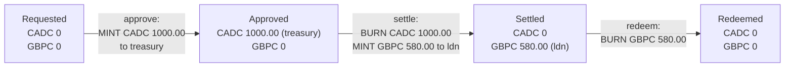

# The tokens: CADC and GBPC, line by line

> Companion docs: [README.md](README.md) · [chaincode-explained.md](chaincode-explained.md) · [wallets-explained.md](wallets-explained.md) · [use-case.md](use-case.md)
> **Where the program is:** [README.md, "Where everything is"](README.md#where-everything-is) lists every file and shows what runs where.
> Source: [contracts/treasury/contracts/CurrencyToken.sol](../../contracts/treasury/contracts/CurrencyToken.sol) (91 lines). Every line is explained below. You need no blockchain background.

**Short answer.** A token here is **a table inside a contract**: it lists addresses and how much each one holds. There is no coin object anywhere else. `CADC` stands for Canadian dollars on the chain, `GBPC` for pounds. They are the **same code deployed twice** (source: `contracts/treasury/contracts/CurrencyToken.sol`; on the chain at the addresses `cadc` and `gbpc` in `deployed-addresses.json`), with different names. Only one other contract, `FundingRequest`, may create (**mint**) or destroy (**burn**) them, and it does so only at three moments in the funding flow.

**Contents:** [1. The ideas](#1-the-ideas) · [2. The two tokens](#2-the-two-tokens) · [3. How a balance moves through the flow](#3-how-a-balance-moves-through-the-flow) · [4. The code, line by line](#4-the-code-line-by-line) · [5. What the tokens do not do](#5-what-the-tokens-do-not-do) · [6. Try it](#6-try-it) · [7. Check yourself](#7-check-yourself)

---

## 1. The ideas

| Word | Plain meaning |
|---|---|
| **Token** | A table in a contract: `address → number`. "Anson holds 5 CADC" means the table has `anson's address → 500` |
| **ERC-20** | A common agreement on the names of the functions a token has (`balanceOf`, `transfer`, `approve`, ...) so wallets and tools understand any token. `CurrencyToken` follows it |
| **Mint** | Add to somebody's entry, and to the total. Money is created |
| **Burn** | Take from somebody's entry, and from the total. Money is destroyed |
| **Total supply** | How much exists. Mint raises it, burn lowers it, a transfer leaves it alone |
| **Decimals** | How many digits sit after the point. The chain only stores whole numbers, so `2` decimals means the stored number `100000` is shown as `1000.00` |
| **Controller** | The one address allowed to mint and burn. Here it is the `FundingRequest` contract, never a person |

Why whole numbers: computers add whole numbers exactly, but `0.1 + 0.2` in floating point is `0.30000000000000004`. Money code must never do that, so everything in this project is an integer count of cents or pence, from the web page to the contract.

## 2. The two tokens

| | `CADC` | `GBPC` |
|---|---|---|
| Name and symbol | `Canadian Dollar Coin`, `CADC` | `Pound Sterling Coin`, `GBPC` |
| Stands for | 1.00 CAD per 1.00 token | 1.00 GBP per 1.00 token |
| Decimals | 2 (stored `100000` = `1000.00`) | 2 (stored `58000` = `580.00`) |
| Code | `CurrencyToken.sol` | the same file, deployed a second time |
| Who may mint and burn | only `FundingRequest` | only `FundingRequest` |
| Exists when | a request is `Approved` | a request is `Settled` |
| Address | `deployed-addresses.json`, key `cadc` | `deployed-addresses.json`, key `gbpc` |

`COIN` (the T-REX token used in the rest of the project) is unrelated. It has identity checks and 18 decimals; these two have neither.

## 3. How a balance moves through the flow

The same numbers as [use-case.md](use-case.md), seen from the tokens:



At every moment, CADC outstanding equals the CAD of the `Approved` requests and GBPC outstanding equals the GBP of the `Settled` ones. The tests check this after every step.

---

## 4. The code, line by line

Line numbers match the file. Read each block, then its table.

### Lines 1 to 7: the header

```solidity
 1  // SPDX-License-Identifier: UNLICENSED
 2  pragma solidity 0.8.28;
 3
 4  /// A minimal ERC-20 for one currency (2 decimals). Only the `controller` can mint and burn.
 5  /// The controller is the FundingRequest contract and is set once by the admin (TD-02).
 6  /// Reverts use plain strings: FireFly's error text carries only Error("...") reasons.
 7  contract CurrencyToken {
```

| Line | What it does |
|---|---|
| 1 | A comment that names the licence. `UNLICENSED` means "not open source", which is right for a demo. The compiler warns if it is missing |
| 2 | Says which compiler version may build this file. Not `^0.8.28` ("this or newer") but exactly `0.8.28`, so the bytecode on the chain is always the one we tested |
| 3 | Blank |
| 4 to 6 | `///` comments describe the contract. They change nothing at run time. Line 6 explains a choice you will see below: errors are plain words such as `"NotController"`, because FireFly's error reports only show errors written as `Error("...")`. A newer Solidity style (custom errors) would show up as "no reason given" |
| 7 | Opens the contract. A contract is like a class: it has stored values (state) and functions. It lives at one address once deployed. The `}` on line 91 closes it |

### Lines 8 to 17: what the contract remembers

```solidity
 8      string public name;
 9      string public symbol;
10      uint8 public constant decimals = 2;
11
12      uint256 public totalSupply;
13      mapping(address => uint256) private balances;
14      mapping(address => mapping(address => uint256)) private allowances;
15
16      address public immutable admin;
17      address public controller;
```

| Line | What it does |
|---|---|
| 8 | A text value `name`, for example `Canadian Dollar Coin`. `public` makes Solidity create a free read function called `name()` |
| 9 | The short symbol, for example `CADC`. Also readable as `symbol()` |
| 10 | `decimals` is a whole number (`uint8`: 0 to 255). `constant` means it is written into the code and can never change, so it costs nothing to read. Always `2` |
| 12 | `totalSupply`: how many token units exist. `uint256` is an unsigned whole number of 256 bits (about 10^77), far bigger than any amount here. "Unsigned" means it can never be negative |
| 13 | The **ledger itself**. A `mapping` is a table from key to value: from an `address` (a wallet) to how many units it holds. Missing keys read as 0. `private` means no outside caller can read the table directly; the getter on lines 31 to 33 is the way in (see below for why) |
| 14 | A table of tables: for an owner, and for a spender, how much the owner has allowed that spender to move for them. This is the ERC-20 "allowance" feature (lines 68 to 82). Not used by the funding flow |
| 16 | `admin`: the address that deployed the token. `immutable` means it is set once, when the contract is created, and can never change, like a constant that is decided at deploy time |
| 17 | `controller`: the one address allowed to mint and burn. It starts empty (the zero address) and is set exactly once by `setController` (line 39) |

### Lines 19 to 21: events

```solidity
19      event Transfer(address indexed from, address indexed to, uint256 value);
20      event Approval(address indexed owner, address indexed spender, uint256 value);
21      event ControllerSet(address indexed controller);
```

An **event** is a note the contract writes into the transaction's log. Nothing in the contract reads it; outside tools (FireFly, the Explorer, auditors) do. `indexed` makes a field searchable ("show me every Transfer to this address").

| Line | What it does |
|---|---|
| 19 | Announced on every move of tokens. By ERC-20 convention a **mint** is a `Transfer` *from* the zero address and a **burn** is a `Transfer` *to* the zero address, so wallets show them correctly |
| 20 | Announced when someone sets an allowance (line 70) |
| 21 | Announced once, when the controller is set (line 44) |

### Lines 23 to 28: the constructor

```solidity
23      constructor(string memory name_, string memory symbol_, address admin_) {
24          require(admin_ != address(0), "BadAdmin");
25          name = name_;
26          symbol = symbol_;
27          admin = admin_;
28      }
```

The constructor runs **once**, at deployment, and never again. This is where `CADC` and `GBPC` become different: the deploy plan passes `("Canadian Dollar Coin", "CADC", admin)` the first time and `("Pound Sterling Coin", "GBPC", admin)` the second.

| Line | What it does |
|---|---|
| 23 | The three values the deployer must supply. `memory` means a temporary copy of the text. The trailing `_` in the names only avoids clashing with the stored `name`, `symbol`, `admin` |
| 24 | `require(condition, "Message")` is the safety check used everywhere in this project: if the condition is false, the whole transaction is undone and the message is the reason. Here: the admin must not be the zero address (`address(0)` means "nobody"), because then nobody could ever set the controller |
| 25 to 27 | Store the three values |

### Lines 30 to 37: reading balances

```solidity
30      // Explicit getters, not public mappings: FireFly passes inputs by name and a mapping getter has none.
31      function balanceOf(address account) external view returns (uint256) {
32          return balances[account];
33      }
34
35      function allowance(address owner, address spender) external view returns (uint256) {
36          return allowances[owner][spender];
37      }
```

| Line | What it does |
|---|---|
| 30 | Explains the choice. If line 13 said `public`, Solidity would build a `balanceOf` for us, but its input would have **no name**. FireFly passes inputs by name (`{"account": "0x..."}`), so we write the function ourselves to give the input a name |
| 31 | A function anyone can call. `external`: callable from outside only. `view`: it only reads and never changes anything, so calling it is free and needs no transaction. Takes an `account`, returns a number |
| 32 | Looks the address up in the table. An address that never held anything gives 0 |
| 35 to 37 | The same for allowances: what `spender` may still move on behalf of `owner` |

### Lines 39 to 45: setting the controller (once)

```solidity
39      function setController(address controller_) external {
40          require(msg.sender == admin, "NotAdmin");
41          require(controller == address(0), "ControllerSet");
42          require(controller_ != address(0), "BadController");
43          controller = controller_;
44          emit ControllerSet(controller_);
45      }
```

`msg.sender` is the address that called the function. The chain checks the signature, so it cannot be faked.

| Line | What it does |
|---|---|
| 39 | Anyone may *try* to call it; the checks decide |
| 40 | Only the admin. Anyone else gets `NotAdmin` and nothing changes |
| 41 | Only if no controller is set yet. This is the "set once" lock: a second call gets `ControllerSet`. After this, not even the admin can swap the controller |
| 42 | The new controller cannot be the zero address, which would lock minting forever |
| 43 | Stores it |
| 44 | Writes the `ControllerSet` event |

`python scripts/stack.py treasury` calls this twice, once per token, passing the `FundingRequest` address. After that, the admin has no power over the money.

### Lines 47 to 53: mint

```solidity
47      function mint(address to, uint256 amount) external {
48          require(msg.sender == controller, "NotController");
49          require(to != address(0), "BadRecipient");
50          totalSupply += amount;
51          balances[to] += amount;
52          emit Transfer(address(0), to, amount);
53      }
```

| Line | What it does |
|---|---|
| 47 | Create `amount` units for `to` |
| 48 | **The key rule.** Only the controller (`FundingRequest`) may mint. A wallet, the admin, anyone else: `NotController` |
| 49 | Not to the zero address (those units would be lost) |
| 50 | The total goes up |
| 51 | The holder's entry goes up. Since Solidity 0.8 an addition that would overflow stops the transaction instead of wrapping around, so there is no hidden overflow bug |
| 52 | Logs a `Transfer` from the zero address, the convention for "minted" |

### Lines 55 to 61: burn

```solidity
55      function burn(address from, uint256 amount) external {
56          require(msg.sender == controller, "NotController");
57          require(balances[from] >= amount, "InsufficientBalance");
58          balances[from] -= amount;
59          totalSupply -= amount;
60          emit Transfer(from, address(0), amount);
61      }
```

| Line | What it does |
|---|---|
| 55 | Destroy `amount` units held by `from` |
| 56 | Again only the controller. Note what this means: `FundingRequest` can burn from the treasury or from a beneficiary **without their signature or an allowance**. That is the design (the contract is the only caller, and it only does so inside `settle` and `redeem`), and it is why that contract must be small and tested |
| 57 | You cannot burn what is not there. This is also why `redeem` fails with `InsufficientBalance` if the beneficiary has already sent the GBPC elsewhere |
| 58 | The holder's entry goes down. If it would go below 0, Solidity 0.8 stops the transaction |
| 59 | The total goes down |
| 60 | Logs a `Transfer` to the zero address, the convention for "burned" |

### Lines 63 to 90: ordinary ERC-20 moves

```solidity
63      function transfer(address to, uint256 amount) external returns (bool) {
64          _transfer(msg.sender, to, amount);
65          return true;
66      }
67
68      function approve(address spender, uint256 amount) external returns (bool) {
69          allowances[msg.sender][spender] = amount;
70          emit Approval(msg.sender, spender, amount);
71          return true;
72      }
73
74      function transferFrom(address from, address to, uint256 amount) external returns (bool) {
75          uint256 allowed = allowances[from][msg.sender];
76          require(allowed >= amount, "InsufficientAllowance");
77          if (allowed != type(uint256).max) {
78              allowances[from][msg.sender] = allowed - amount;
79          }
80          _transfer(from, to, amount);
81          return true;
82      }
83
84      function _transfer(address from, address to, uint256 amount) private {
85          require(to != address(0), "BadRecipient");
86          require(balances[from] >= amount, "InsufficientBalance");
87          balances[from] -= amount;
88          balances[to] += amount;
89          emit Transfer(from, to, amount);
90      }
```

These are the standard ERC-20 functions. The funding flow never uses them; they exist so the tokens behave like any other token in tools.

| Line | What it does |
|---|---|
| 63 to 66 | `transfer`: the caller sends `amount` of their own tokens to `to`. It calls the shared helper `_transfer` with the caller as the sender. Returns `true` because the ERC-20 agreement says so |
| 68 to 72 | `approve`: the caller allows `spender` to move up to `amount` of the caller's tokens later. Line 69 writes the allowance, line 70 logs it |
| 74 | `transferFrom`: a spender moves tokens *for* an owner, using an allowance |
| 75 | Reads how much this caller (`msg.sender`) may still move for `from` |
| 76 | Refuses if the allowance is smaller than the amount |
| 77 to 79 | Lowers the allowance by what was used, **unless** the allowance is the largest possible number (`type(uint256).max`), which by convention means "unlimited" and is left alone |
| 80 | Does the move |
| 84 | `_transfer`: the shared helper. A leading `_` and `private` mean only this contract can call it |
| 85 | Not to the zero address (use `burn` to destroy tokens, which only the controller can do) |
| 86 | The sender must hold enough |
| 87 and 88 | Subtract from the sender, add to the receiver. The total does not change |
| 89 | Logs the `Transfer` |
| 91 | Closes the contract |

---

## 5. What the tokens do not do

- **No pause, freeze or blacklist.** If `ldn` sends its GBPC to another wallet before `redeem`, nothing stops it, and then `redeem` fails with `InsufficientBalance`. The integration tests cover this case.
- **No identity checks.** Unlike `COIN`, any address can hold CADC or GBPC. Who may *create* them is what is controlled.
- **No way to change the controller** after it is set, and no upgrade. A fix means a new deploy.
- **No limit per request in the token.** The cap (CAD 1,000,000.00) is enforced by `FundingRequest`.

## 6. Try it

Read balances with `curl` (the stack up, `deploy` and `treasury` run). The treasury wallet's address is in `network-config/wallets.json`.

```bash
curl -s -X POST http://localhost:5000/api/v1/namespaces/default/apis/cadc/query/totalSupply \
  -H 'Content-Type: application/json' -d '{}'
# {"output": "0"}

curl -s -X POST http://localhost:5000/api/v1/namespaces/default/apis/cadc/query/balanceOf \
  -H 'Content-Type: application/json' \
  -d '{"input": {"account": "0xab5c492ef23ff5364a06eecfab5454670fda0803"}}'
# {"output": "0"}
```

Then run the funding flow ([README](../../README.md), "Try the treasury branch-funding flow") and repeat the calls while a request sits in `Approved` (put the FX file out of date so it waits): `totalSupply` and the treasury balance both show `100000` for a CAD 1,000.00 request.

You can also see each mint and burn in the FireFly Explorer (`http://localhost:5000/ui`, Blockchain, Operations): one `approve`, one `settle`, one `redeem` per request.

## 7. Check yourself

1. A request for CAD 12.34 is approved. What number does `balanceOf(treasury)` return on `CADC`? *(1234.)*
2. Can the admin mint CADC? *(No. Only the controller, and the controller is `FundingRequest`; line 48.)*
3. Why is the `balances` table `private` but `balanceOf` exists? *(Callers use the getter; we wrote it ourselves to give its input a name FireFly can pass.)*
4. What stops a second `setController` call? *(Line 41: the controller is no longer the zero address.)*
5. After `settle` and `redeem` of one request, what is the total supply of each token? *(0 and 0.)*
