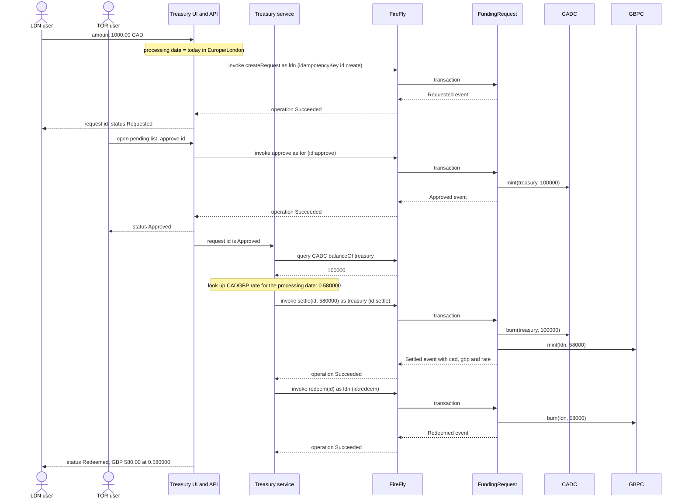
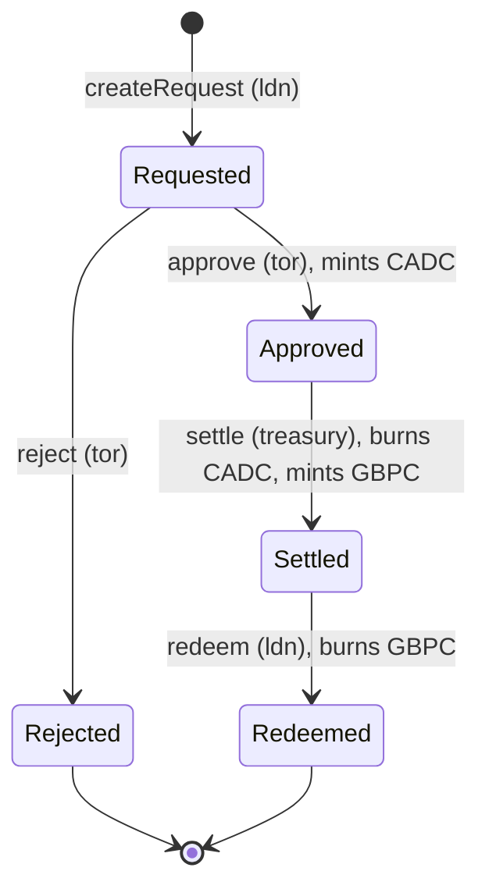

# Use cases: branch funding

> Companion docs: [README.md](README.md) · [prd.md](prd.md) · [design.md](design.md) · [test-plan.md](test-plan.md)
> Numbering `UC-T1` and up, so it does not collide with `docs/use-cases.md` (UC-01 to UC-11).

## Actors

| Actor | Role | Wallet (TD-10) |
|---|---|---|
| LDN end user | Requests funding for the London branch. Receives and redeems GBP | `ldn` |
| TOR end user | Approves or rejects requests. Holds the approver role | `tor` |
| Treasury service | Part of the one app. Looks up the FX rate and settles. Signs as the treasury wallet | `treasury` |
| Admin | Deploys the contracts and grants roles. Not part of the funding flow | `admin` (exists) |
| Treasury UI | One web page and one HTTP API for every branch (TD-07) | none, it signs through FireFly |
| FireFly | One instance, gateway mode. Signs for every wallet | |
| Besu RPC node | One node, `besu-rpc-anson` | |
| `FundingRequest`, `CADC`, `GBPC` | The contracts. The real authorization boundary | |

## UC-T1: Fund LDN in GBP from a CAD request (main flow)

**Goal:** LDN asks for CAD 1,000.00. TOR approves. The treasury converts at 0.580000. LDN receives GBP 580.00 and redeems it. All balances end at zero and every step is on the chain.

**Trigger:** LDN end user opens the UI and submits the form.

**Preconditions:** the stack is up and `deploy` and `treasury` (task 7) have run; the wallets `ldn`, `tor`, `treasury` exist with roles; the FX file has a rate for the processing date or a `default`.

**Success criteria:**
- The request ends `Redeemed`.
- `CADC` and `GBPC` total supply are both 0 afterwards, and `ldn`'s GBPC balance is 0.
- The `Settled` event holds the CAD amount, the GBP amount and the rate used. The `Redeemed` event holds the GBP amount.
- The UI shows, for the request: the four transaction ids, the rate, both amounts and the processing date.

**Notes:**
- Amounts are integers in minor units (cents, pence). 1,000.00 CAD is 100000; 580.00 GBP is 58000 (TD-11).
- Steps 5 to 7 run without a human: the Treasury service reacts when the request becomes `Approved`, and the LDN redeem is signed by the `ldn` wallet through FireFly because the UI holds no keys (open question Q2).
- Test: `test_funding_happy_path` ([test-plan.md](test-plan.md)).

## Request state machine

No other transition is allowed. A call from the wrong state or the wrong wallet reverts and changes nothing.

## UC-T2: TOR rejects a request

**Goal:** a request that TOR does not want to fund ends without minting anything.

**Flow:** LDN creates (UC-T1 up to `Requested`). TOR chooses reject and gives a reason (max 140 characters). UI invokes `reject(id, reason)` as `tor`. State `Rejected`, reason in the event. No token is minted.

**Test:** `test_reject_mints_nothing`.

## UC-T3: Failure and edge paths

| # | Situation | What the system does | Where it is enforced |
|---|---|---|---|
| F1 | Amount is zero, negative, not a number, more than 2 decimals, or above the cap | UI rejects it before any transaction; the contract also reverts if it gets one | core validation and contract |
| F2 | LDN user tries to approve their own request, or any non-approver tries | Revert `NotApprover` or `SelfApproval`; state unchanged | contract |
| F3 | Approve a request twice, or settle before approval | Revert `BadState`; no second mint | contract |
| F4 | UI shows the same button twice (double click, retry after a timeout) | Same `idempotencyKey` (`<id>:<action>`), FireFly answers HTTP 409 `FF10431`; the UI treats it as "already submitted" and polls the first operation | adapter, reuses `AlreadySubmitted` |
| F5 | FireFly does not finish within the poll window | UI shows `Pending` with the operation id, never "success" (same rule as `besu-ff`, UC-11) | core `outcome` |
| F6 | No FX rate for the date and no `default` | Request stays `Approved`. UI says "FX rate missing for 2026-10-18". CADC stays in the treasury wallet. Adding the rate and pressing "retry settle" finishes it | core FX lookup |
| F7 | Settlement transaction fails after approval | Request stays `Approved`, CADC still held by treasury, nothing was burned or minted (the transaction is atomic). Retry is safe | contract atomicity |
| F8 | The app restarts between `Approved` and `Settled` | On start the Treasury service lists `Approved` requests and settles them; `idempotencyKey` stops a double settlement | service recovery sweep |
| F9 | Wrong wallet calls `settle` or a rate of 0 is passed | Revert `NotTreasury` or `BadRate` | contract |
| F10 | `redeem` by someone other than the beneficiary | Revert `NotBeneficiary` | contract |

**Principle:** the money moves only in contract calls that are atomic. If a step fails, the request stays in the last good state and the next step can be retried. There is no state where CADC and GBPC both exist for one request.

## UC-T4: Look at the whole picture

**Goal:** an auditor or the developer sees what happened without reading raw logs.

**Flow:** open the UI "Ledger" tab. It lists every request with status, branch, amount, processing date, rate, GBP amount and transaction ids. Balances for `ldn`, `tor`, `treasury` in CADC and GBPC and both total supplies are shown. The same events are visible in the FireFly Explorer (`docs/firefly-user-guide.md`).

**Test:** `test_ledger_matches_chain`.

## UC-T5: Prepare the demo environment

**Goal:** the treasury contracts, roles and wallets exist and the app starts.

**Flow:** `python scripts/stack.py up`, `deploy`, then `python scripts/stack.py treasury` (idempotent: only does what is missing) and `python scripts/treasury_app.py`. The second command adds the wallets, deploys the three contracts through FireFly, registers their interfaces and APIs, and grants the roles. Re-running changes nothing.

**Test:** `test_treasury_deploy_is_idempotent`.
