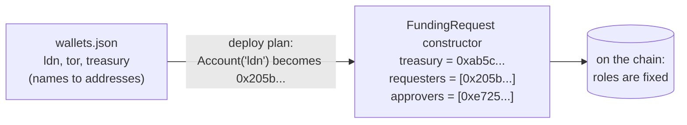
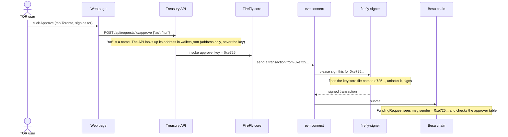

# The treasury wallets: ldn, tor and treasury

> Companion docs: [README.md](README.md) · [tokens-explained.md](tokens-explained.md) · [chaincode-explained.md](chaincode-explained.md) · [use-case.md](use-case.md)
> **Where the program is:** [README.md, "Where everything is"](README.md#where-everything-is) lists every file and shows what runs where.
> For what a wallet is in general here (key, keystore, how the signer accepts it), read [../wallets.md](../wallets.md). This page covers only what the treasury use case adds. You need no blockchain background.

**Short answer.** The use case adds **three wallets**: `ldn`, `tor` and `treasury`. Each is a private key with a name. The `FundingRequest` contract is told, when it is deployed, which address plays which role, and from then on it accepts that role only from that address. **No wallet mints or burns by itself, and there is no "minter" wallet**: a wallet only asks the contract, and the contract does the minting and burning. The fourth wallet you will see, `admin`, already existed; it deploys the contracts and then has no power over the money.

**Contents:** [1. The wallets](#1-the-wallets) · [2. How they are made](#2-how-they-are-made) · [3. How a step gets signed](#3-how-a-step-gets-signed) · [4. What each wallet holds and when](#4-what-each-wallet-holds-and-when) · [5. What each wallet cannot do](#5-what-each-wallet-cannot-do) · [6. Changing who plays a role](#6-changing-who-plays-a-role) · [7. Demo keys, and what changes for real](#7-demo-keys-and-what-changes-for-real) · [8. Look at them](#8-look-at-them)

---

## 1. The wallets

| Name | Address (this repo's demo) | Plays | Signs which step | Holds tokens |
|---|---|---|---|---|
| `ldn` | `0x205b28bb3bb87a95ab8527e36c937b3556de3603` | **requester**, and the **beneficiary** of the GBP | `createRequest`, `redeem` | GBPC, only between `settle` and `redeem` |
| `tor` | `0xe725c98fb2fc1381b3104ad9fb619ff47ba2c136` | **approver** | `approve`, `reject` | never |
| `treasury` | `0xab5c492ef23ff5364a06eecfab5454670fda0803` | **treasury**: receives the CADC and settles | `settle` | CADC, only between `approve` and `settle` |
| `admin` (existing) | `0x6789a6e90e2a7ede268916170a43ce658ae4aae1` | deployer | the deploy transactions, and `setController` on each token | never |

The addresses are in [network-config/wallets.json](../../network-config/wallets.json). They are **throwaway demo keys, committed on purpose** (plan decision D-10). The names (`ldn`, `tor`, `treasury`) exist only in this repo's files and in the web page's code; **the chain knows only the addresses**.

Roles are not stored in the wallets. They are stored **in the contract**, set when it is deployed:



## 2. How they are made

`python scripts/stack.py treasury` runs `ensure_wallets` ([src/adapters/treasury_deploy.py](../../src/adapters/treasury_deploy.py)) before it deploys anything:

1. **Read** `network-config/wallets.json`.
2. **Create what is missing.** For each of `ldn`, `tor`, `treasury` not yet in the file, generate a random private key (the `eth_account` library) and derive its address from it. A wallet that already exists is **never replaced**, so running the command again changes nothing.
3. **Save** the file (names must be unique, and every address is checked against its key).
4. **Give the signer the key.** For each wallet, write an encrypted **keystore file** and a small `.toml` descriptor into `network-config/firefly/signer-data/keystore/`, named by the address. These are **not committed** (git ignores them); they are rebuilt from `wallets.json` whenever they are missing.
5. **Restart the signer** (`firefly-signer`) if it does not list all the new addresses yet, and wait until it does. It reads its keystore folder when it starts.

Only after that does it deploy the contracts, using the addresses just made. That order matters: the contract needs the final addresses in its constructor.

The same mechanics, with pictures, are in [../wallets.md](../wallets.md) sections 1 to 4.

## 3. How a step gets signed

The web page and the treasury service **never touch a private key**. They send FireFly a request that names the wallet **by address** (`"key": "0x205b..."`), and FireFly's signer, a separate container that holds the keystores, signs.



Three consequences worth knowing:

- **The page's "Sign as" box is not security.** If you pick `ldn` on the Toronto tab, FireFly really does sign as `ldn`, and the *contract* answers `NotApprover`. The allow-list in the API only stops typos. Who may do what is decided on the chain.
- **`msg.sender` cannot be faked.** The contract trusts the address that the signature proves. A caller cannot claim to be `tor` without `tor`'s key.
- **Nonce and gas are handled for you.** `evmconnect` counts each wallet's transactions (the nonce) and sets gas (zero-price on this chain), so two clicks from the same wallet do not collide.

## 4. What each wallet holds and when

For one request of CAD 1,000.00 at 0.58:

| Moment | `ldn` CADC / GBPC | `tor` | `treasury` CADC / GBPC |
|---|---|---|---|
| Before anything | 0.00 / 0.00 | nothing | 0.00 / 0.00 |
| After `createRequest` | 0.00 / 0.00 | nothing | 0.00 / 0.00 |
| After `approve` | 0.00 / 0.00 | nothing | **1000.00** / 0.00 |
| After `settle` | 0.00 / **580.00** | nothing | 0.00 / 0.00 |
| After `redeem` | 0.00 / 0.00 | nothing | 0.00 / 0.00 |

`tor` never holds a token: it only gives permission. Notice also that **`treasury` and `ldn` never hold the same currency for one request at the same time**; the Ledger tab shows these balances and a green "Books balance" line.

## 5. What each wallet cannot do

Tried against the live chain (integration tests) and in the contract tests:

| Wallet | Tries | Contract answers |
|---|---|---|
| `ldn` | `approve` or `reject` any request, including its own | `NotApprover` |
| `tor` | `createRequest` | `NotRequester` |
| `tor` | `settle` | `NotTreasury` |
| `tor` or `treasury` | `redeem` someone else's GBP (once it is settled; before that, `BadState`) | `NotBeneficiary` |
| `treasury` | `approve` | `NotApprover` |
| anyone | `mint` or `burn` on `CADC` or `GBPC` directly | `NotController` |
| any holder | `transfer`, `approve` or `transferFrom` on `CADC` or `GBPC` | refused: the functions do not exist, so tokens stay where the flow put them |
| `admin` | `mint` on `CADC` or `GBPC` | `NotController` |
| `admin` | `setController` a second time | `ControllerSet` |
| a wallet that is both requester and approver (not in this deploy) | approve its own request | `SelfApproval` |

All of these leave the chain unchanged: a refused transaction mints and burns nothing.

## 6. Changing who plays a role

**Roles are fixed when `FundingRequest` is deployed.** There is no function to add or remove a requester, approver or treasury. This keeps v1 small, but it has consequences:

| You want to | What it takes |
|---|---|
| Add a second approver (say `tor2`) | Add the wallet, then deploy a **new** `FundingRequest` with `approvers = [tor, tor2]` and point the two tokens at it. But each token's controller can be set **only once**, so new tokens (`cadc`, `gbpc`) are needed too: in this demo, `python scripts/stack.py reset`, then `up`, `deploy`, `treasury` with the changed plan in `src/core/treasury/plan.py` |
| Add a branch (say `nyc`) that asks for funding | The same: it must be in the `requesters` list at deploy |
| Rotate a key | A new wallet, and a redeploy as above. The old address stays trusted by the old contract |
| Remove a role | A redeploy |

If you want these to be possible without a redeploy, the next design step is a role-management function in `FundingRequest`, callable only by an owner wallet, with a test for each. That is a deliberate non-goal of v1 ([design.md](design.md) §3).

**A warning about regenerating.** `python scripts/stack.py init --force` rewrites `wallets.json` with only `admin`, `anson` and `beatrice`. The three treasury wallets would disappear, while a contract already deployed would still trust their old addresses and nobody would hold those keys any more. After `init --force`, always `reset` and redeploy.

## 7. Demo keys, and what changes for real

- The private keys are in a file in git. Anyone with the repo can sign as `tor`. That is fine only because the network has no real value and runs on one machine.
- The keystore password is one shared demo value.
- There is **no login** on the web page. The wallet choice is a demo convenience.

For anything real: each person's key stays with that person (a hardware wallet or a key-management service, never a file in git); one wallet per human, with the contract roles mapped to them; `treasury` held by a controlled service with its own approval policy; a login in front of the page; and a role-management function and an upgrade plan for the contract. [../production-step-by-step.md](../production-step-by-step.md) lists what that takes.

## 8. Look at them

```bash
# the names and addresses (private keys are in the same file: do not paste them anywhere)
python -c "import json;[print(w['name'], w['address']) for w in json.load(open('network-config/wallets.json'))['wallets']]"

# the addresses the signer will sign for (the signer publishes no port, so ask from inside its container)
docker exec firefly-signer curl -sf -X POST -H 'Content-Type: application/json' \
  --data '{"jsonrpc":"2.0","id":1,"method":"eth_accounts","params":[]}' http://localhost:8545

# does the contract trust an address as approver? (true for tor, false for ldn)
curl -s -X POST http://localhost:5000/api/v1/namespaces/default/apis/funding-request/query/isApprover \
  -H 'Content-Type: application/json' -d '{"input": {"account": "0xe725c98fb2fc1381b3104ad9fb619ff47ba2c136"}}'
```

In the FireFly Explorer (`http://localhost:5000/ui`, Blockchain, Operations) every write shows the wallet address that signed it. Match those addresses against the table in section 1 to see, for one request, `ldn` create, `tor` approve, `treasury` settle and `ldn` redeem.
